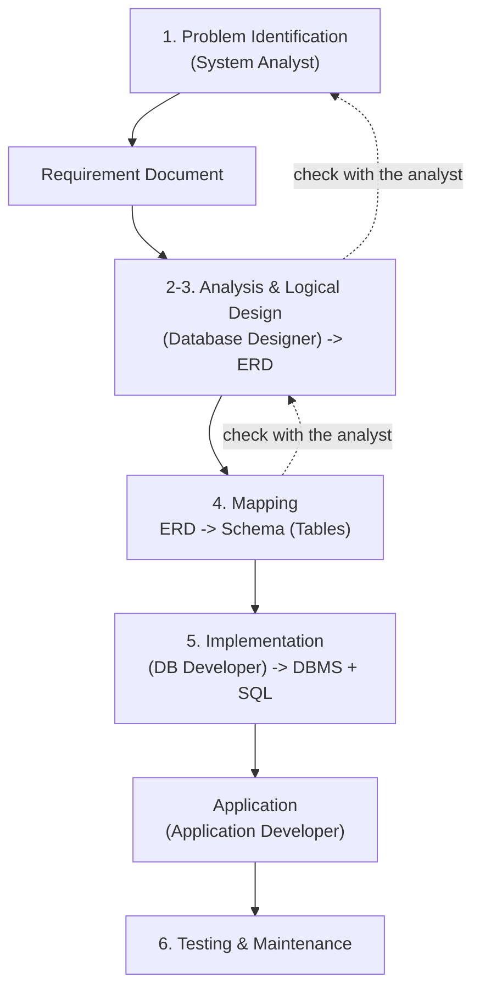
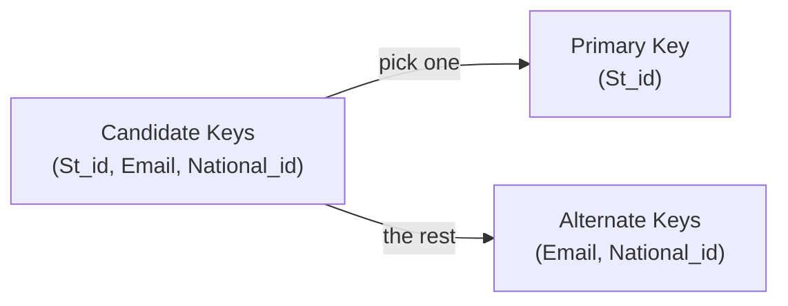

# Lecture 1: Database Life Cycle, DBMS & ERD

> **In one sentence:** Before writing any `CREATE TABLE`, there is a whole process: understand the client, draw an ERD, convert it to tables, then implement it. This lecture covers that process, why a DBMS is better than plain files, and the basics of the ERD.

## Table of Contents

1. Database Life Cycle
2. File-Based Systems vs DBMS
3. Database Users (Roles)
4. ERD
5. Quick Revision
---

## 1. Database Life Cycle

### The whole journey

### The six phases

|#|Phase|Who does it|Output|
|---|---|---|---|
|1|**Problem Identification**|System Analyst|**Requirement Document** (the scope)|
|2|**Analysis**|System Analyst + Designer|Detailed understanding of the requirements|
|3|**Logical Design**|Database Designer|**ERD**|
|4|**Mapping**|Database Designer|The **schema** (the actual tables)|
|5|**Implementation**|DB Developer|The database on a **DBMS**, written in SQL|
|6|**Testing & Maintenance**|Everyone|A stable, working system|

### The first problem: the client

How do I, as a developer, understand what the client wants? The client does not speak "programming", and I do not speak "banking" or "healthcare".

**Solution: the System Analyst.**

- Has strong software experience.
- Talks to the **client in the client's language**, and to the **developer in the developer's language**.
- Produces the **Requirement Document (Scope)**, which says in detail what must be built.
- Can be specialized: _Banking System Analyst_, _Financial System Analyst_, etc.

### Moving between phases

1. **Requirement Document -> ERD** (by the Database Designer).
2. **ERD -> Mapping:** a set of rules that turns the ERD into a schema (real tables).
3. **Schema -> Implementation:** build it on a DBMS.

> [!WARNING] The same requirement document can produce **more than one valid ERD**. That is why, after **every phase**, we go back to the System Analyst and confirm we are on the right track.

### Implementation phase

- Convert the logical schema into a real database using a **DBMS** (Database Management System), such as SQL Server.
- We use **SQL** (done by the **DB Developer**).
- Once a DBMS is installed, your PC becomes a **DB server**.

> [!IMPORTANT] The database must be **shared**. If everyone has their own copy, the data becomes **inconsistent**.

### Application phase

- This is the part the **end user** deals with.
- The end user **does not talk to the database directly**.
- The **Application Developer** sits in between: they connect the database to the end user.
- From the database's point of view, the application is the **DB user**.

---

## 2. File-Based Systems vs DBMS

### File-based systems

Data is stored in normal files:

- **Delimited files** (values separated by a character, e.g. CSV)
- **Fixed-width files** (each column has a fixed width)
- Even an **Excel sheet**

#### Disadvantages

| Problem                       | Explanation                                               |
| ----------------------------- | --------------------------------------------------------- |
| Hard to search                | No query language                                         |
| Low performance               | Gets slow with big data                                   |
| Separate copies               | The Student file has no link to the Department file       |
| No relationships              | Files cannot reference each other                         |
| No integrity                  | Wrong data can be entered easily                          |
| Data duplication              | Same data repeated in many files                          |
| Long development time         | You must build all the missing features yourself          |
| Weak security and permissions | Hard to control who can see or edit what                  |
| No constraints or rules       | Nothing checks the data                                   |
| Poor data quality             | Typos, missing values, etc.                               |
| Manual backup and restore     |                                                           |
| No standard                   | One person uses delimited files, another uses fixed width |
| Hard to integrate             | Different systems cannot easily share data                |

### Database systems (DBMS)

#### Advantages

- **One standard:** tables, columns, relationships.
- **Metadata** is stored with the data (**Data + Metadata**).
- Every column has a **data type** (a kind of constraint).
- **Centralized and shared** database.
- Enforces **integrity**.
- **Restricts unauthorized access.**
- **Program-Data Independence:**
    - Metadata is stored in the DBMS, so applications do not worry about the data format.
    - Queries and updates are managed by the DBMS.
- Also: backup/restore, multiple users at the same time, and more.

#### Disadvantages

- Needs **expertise** to use.
- Some DBMSs are **expensive**.
- A DBMS may be **incompatible** with other DBMSs.

> [!NOTE]
>
> - **Data:** raw facts (example: `25`).
> - **Metadata:** data about data (example: the column is named `age` and its type is `int`).

---

## 3. Database Users (Roles)

| Role                             | What they do                                                  |
| -------------------------------- | ------------------------------------------------------------- |
| **DBA** (Database Administrator) | Manages the DBMS: permissions, security, backups, performance |
| **System Analyst**               | Gathers requirements and writes the Requirement Document      |
| **Database Designer**            | Draws the ERD and does the Mapping                            |
| **Database Developer**           | Builds the database with SQL (tables, procedures, ...)        |
| **Application Programmer**       | Writes the application that connects to the database          |
| **End User**                     | Uses the application (never sees the database)                |

---

## 4. ERD (Entity-Relationship Diagram)

> [!IMPORTANT] **Never assume anything that is not in the Requirement Document.** Go back and ask the System Analyst. (In practice exercises where nobody can answer, write your **assumptions** clearly instead of staying silent about them.)

### The 3 basic building blocks

|Block|Meaning|Becomes in a database|
|---|---|---|
|**Entity**|A person, place, object, event, or concept that is distinguishable from others|**Table**|
|**Attribute**|A property or characteristic of an entity|**Column**|
|**Relationship**|A link between entities|**PK-FK** between tables|

### Drawing symbols

|Shape|Represents|
|---|---|
|Rectangle|Entity|
|Diamond|Relationship|
|Ellipse (oval)|Attribute|

### Strong vs Weak Entity

||**Strong Entity**|**Weak Entity**|
|---|---|---|
|Definition|Has a **primary key**|Does **not** have enough attributes to form a primary key|
|Dependency|Independent|**Depends on** a strong entity|
|Drawing|Normal rectangle|**Double rectangle**|
|Key|Primary key (underlined)|**Partial key** (dashed underline)|

**Example: `Employee` and `Dependent` (family members)**

- `Employee` is strong. It has `Emp_id`.
- `Dependent` is weak. A name alone can repeat (two employees may each have a child named "Ahmed").
- Its full identity = `Emp_id` (from the strong entity) + `Dependent_name` (the partial key).
- The link between them is drawn with a **double diamond** (identifying relationship).

---

### Types of attributes

|Type|Meaning|Example|Drawing|
|---|---|---|---|
|**Simple**|One atomic value that cannot be split|`Age`, `Salary`|Normal ellipse|
|**Composite**|Can be split into parts|`Name` -> (`Fname`, `Lname`)|Ellipse with child ellipses|
|**Multi-valued**|Can hold **more than one value**|`Phone` (several numbers)|**Double ellipse**|
|**Derived**|Calculated from another attribute|`Age` from `BirthDate`|**Dashed ellipse**|
|**Complex**|Composite and multi-valued nested together|`Address` (many addresses, each with street and city)|Combined|

---
### Relationship properties

A relationship can have its own attributes. Example: `Student -- takes --> Course` has an attribute `Grade` (the grade belongs to the link, not to the student alone or the course alone).

A relationship has **3 properties**:

#### 1. Degree: how many entities take part?

| Type                  | Entities               | Example                        |
| --------------------- | ---------------------- | ------------------------------ |
| **Unary** (recursive) | 1 (entity with itself) | `Employee supervises Employee` |
| **Binary**            | 2                      | `Student takes Course`         |
| **Ternary**           | 3                      | `Doctor - Patient - Medicine`  |

#### 2. Cardinality constraint: how many?

How many instances of one entity can (or must) be linked to a single instance of the other entity?

|Type|Meaning|Example|
|---|---|---|
|**One-to-One (1:1)**|One to one|`Department - managed by - Manager`|
|**One-to-Many (1:M)**|One to many|`Department - has - Students`|
|**Many-to-Many (M:N)**|Many to many|`Student - takes - Courses`|

#### 3. Participation constraint: must it take part?

Does the entity **have to** take part in the relationship, or only **may** it?

| Type        | Meaning                                        | Drawing         | `min` value |
| ----------- | ---------------------------------------------- | --------------- | ----------- |
| **Total**   | **Must** participate (cannot exist without it) | **Double line** | `min = 1`   |
| **Partial** | **May** participate                            | Single line     | `min = 0`   |

**Example from the lecture:**

- **Every** employee **must** work for a department -> **Total**
- **Only some** employees manage departments -> **Partial**

#### The `(min, max)` notation

`(min, max)` = the smallest and largest number of times an entity can take part in the relationship.

|Notation|Meaning|
|---|---|
|`(0, 1)`|Partial, at most once|
|`(0, N)`|Partial, any number of times|
|`(1, 1)`|Total, exactly once|
|`(1, N)`|Total, at least once|

> [!NOTE] Only the **min** decides participation: `min = 0` is Partial and `min = 1` is Total. The **max** decides the cardinality (1 or N).

---

### Types of keys

|Key|Definition|Example|
|---|---|---|
|**Candidate Key**|Any column (or set of columns) that **could** be the primary key: unique and never repeated|`St_id`, `National_id`, `Email`|
|**Primary Key (PK)**|The candidate key you **chose** (only one, never NULL)|`St_id`|
|**Foreign Key (FK)**|A column that points to a primary key in another table|`dept_id` in `Student`|
|**Composite Key**|A key made of **more than one column**|`(St_id, Crs_id)` in `Takes`|
|**Partial Key**|Identifies a **weak entity** inside the strong entity it depends on|`Dependent_name`|

> [!NOTE] Candidate keys that were **not** chosen as the PK are called **Alternate Keys**.

---