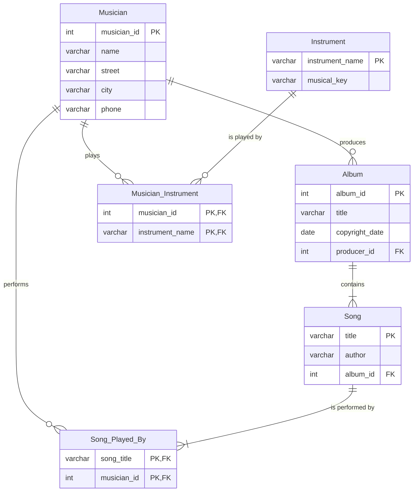

# Lab Problem 1: Musicana Records (Mapping)

## 1. Reading the ERD

### Entities

|Entity|Attributes|
|---|---|
|**Musician**|**ID** (PK), Name, Phone, Address _(composite: St, City)_|
|**Instrument**|**Name** (PK), Key|
|**Album**|**Id** (PK), Title, Date|
|**Song**|**Title** (PK), Author|

### Relationships

|Relationship|Entities|Cardinality|Participation|
|---|---|---|---|
|Play|Musician - Instrument|M:N|partial / partial|
|Play|Musician - Song|M:N|Musician: partial, Song: **total**|
|Produce|Musician - Album|1:M|Musician: partial, Album: **total**|
|Appears at|Album - Song|1:M|Album: **total**, Song: **total**|

## 2. Mapping steps

|#|ERD element|Rule applied|Result|
|---|---|---|---|
|1|Entities Musician, Instrument, Album, Song|Step 1: one table per entity, key attribute becomes the PK|4 tables|
|2|Composite attribute `Address`|Step 1: keep only the parts|Columns `street`, `city`|
|3|`Produce` (1:M, many side = Album, **total**)|Step 4: the PK of the one side becomes an FK in the many side|`Album.producer_id` (FK to Musician, `NOT NULL`)|
|4|`Appears at` (1:M, many side = Song, **total**)|Step 4: same rule|`Song.album_id` (FK to Album, `NOT NULL`)|
|5|`Play` Musician - Instrument (M:N)|Step 5: new table, PK = both keys|`Musician_Instrument`|
|6|`Play` Musician - Song (M:N)|Step 5: new table, PK = both keys|`Song_Played_By`|

There are no weak entities, no 1:1 relationships, no n-ary and no unary relationships in this problem.

## 3. Final schema

(**bold** = PK, _italic_ = FK)

- **Musician** (**musician_id**, name, street, city, phone)
- **Instrument** (**instrument_name**, musical_key)
- **Musician_Instrument** (_**musician_id**_, _**instrument_name**_) PK = both columns together
- **Album** (**album_id**, title, copyright_date, _producer_id_)
- **Song** (**title**, author, _album_id_)
- **Song_Played_By** (_**song_title**_, _**musician_id**_) PK = both columns together

Foreign keys: `Musician_Instrument.musician_id` -> `Musician`, `Musician_Instrument.instrument_name` -> `Instrument`, `Album.producer_id` -> `Musician`, `Song.album_id` -> `Album`, `Song_Played_By.song_title` -> `Song`, `Song_Played_By.musician_id` -> `Musician`.

## 4. Constraint file

Things the tables cannot show by themselves:

- `Musician.Address = street + city`
- **"At least one" rules** (the table structure cannot force them, they need a trigger or application logic):
    - Every song is performed by **at least one** musician (Song is total in `Play`).
    - Every album has **at least one** song (Album is total in `Appears at`).

## 5. Notes

- **Why the FKs are `NOT NULL`:** `Album.producer_id` and `Song.album_id` sit on the **total** side, so a value is always required.
- **Why no extra table for `Produce` and `Appears at`:** the many side is total, so a plain FK is enough (2 tables, not 3).
- **Names:** `Key` and `Date` are SQL keywords, so the columns are called `musical_key` and `copyright_date`. The FK in `Album` is called `producer_id` because it shows the role.