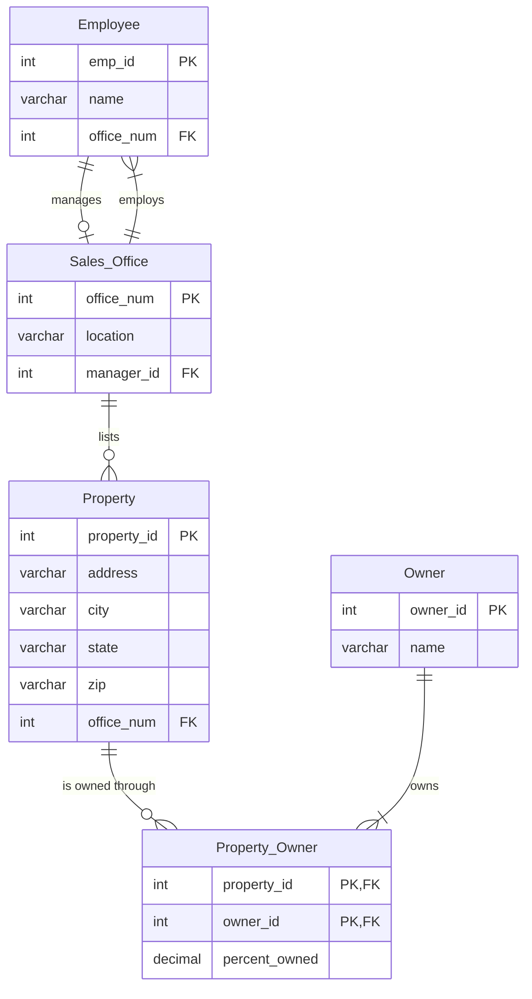

# Lab Problem 2: Real Estate Firm (Mapping)

## 1. Reading the ERD

### Entities

|Entity|Attributes|
|---|---|
|**Sales Office**|**NUM** (PK), Loc|
|**Employee**|**ID** (PK), Name|
|**Property**|**ID** (PK), Loc _(composite: Add, City, State, Zip)_|
|**Owner**|**ID** (PK), Name|

### Relationships

|Relationship|Entities|Cardinality|Participation|Attribute|
|---|---|---|---|---|
|Manage|Sales Office - Employee|1:1|Office: **total**, Employee: partial|-|
|Work|Sales Office - Employee|1:M|Office: **total**, Employee: **total**|-|
|List|Sales Office - Property|1:M|Office: partial, Property: **total**|-|
|Has|Property - Owner|M:N|Property: partial, Owner: **total**|`Percent-owned`|

## 2. Mapping steps

|#|ERD element|Rule applied|Result|
|---|---|---|---|
|1|Entities Sales Office, Employee, Property, Owner|Step 1: one table per entity|4 tables|
|2|Composite attribute `Property.Loc`|Step 1: keep only the parts|`address`, `city`, `state`, `zip`|
|3|`Manage` (1:1, **total on one side** only)|Step 3: 2 tables. The PK of the **partial** side (Employee) goes into the **total** side (Sales Office) as an FK|`Sales_Office.manager_id` (FK, `NOT NULL`, `UNIQUE`)|
|4|`Work` (1:M, many side = Employee, **total**)|Step 4: FK in the many side|`Employee.office_num` (FK, `NOT NULL`)|
|5|`List` (1:M, many side = Property, **total**)|Step 4: FK in the many side|`Property.office_num` (FK, `NOT NULL`)|
|6|`Has` (M:N) + attribute `Percent-owned`|Step 5: new table, PK = both keys. The relationship attribute goes in this table|`Property_Owner`|

## 3. Final schema

(**bold** = PK, _italic_ = FK)

- **Sales_Office** (**office_num**, location, _manager_id_)
- **Employee** (**emp_id**, name, _office_num_)
- **Property** (**property_id**, address, city, state, zip, _office_num_)
- **Owner** (**owner_id**, name)
- **Property_Owner** (_**property_id**_, _**owner_id**_, percent_owned) PK = `property_id` + `owner_id`

Foreign keys: `Sales_Office.manager_id` -> `Employee`, `Employee.office_num` -> `Sales_Office`, `Property.office_num` -> `Sales_Office`, `Property_Owner.property_id` -> `Property`, `Property_Owner.owner_id` -> `Owner`.

## 4. Constraint file

- `Property.Loc = address + city + state + zip`
- The sum of `percent_owned` for one property must not exceed 100 (needs a trigger).
- Every sales office has **at least one** employee (Office is total in `Work`).
- Every owner owns **at least one** property (Owner is total in `Has`).

## 5. Notes

- **Circular foreign keys:** `Sales_Office.manager_id` points to `Employee`, and `Employee.office_num` points back to `Sales_Office`. Each table needs the other to exist first. Solution: create both tables, then add one of the FK constraints afterwards with `ALTER TABLE`. When inserting the first office and its first employee, either let `manager_id` be `NULL` for a moment, or disable the constraint temporarily.
- **Why `manager_id` is `UNIQUE`:** `Manage` is 1:1, so one employee cannot manage two offices.
- **Why `manager_id` is in `Sales_Office`:** the office is the **total** side, so the FK can be `NOT NULL`. In `Employee` it would be `NULL` for most employees.
