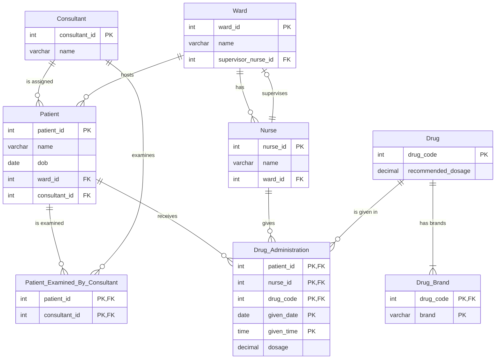

# Lab Problem 3: General Hospital (Mapping)

## 1. Reading the ERD

### Entities

|Entity|Attributes|
|---|---|
|**Patient**|**ID** (PK), Name, DOB|
|**Consultant**|**ID** (PK), Name|
|**Ward**|**ID** (PK), Name|
|**Nurse**|**ID** (PK), Name|
|**Drug**|**Code** (PK), Rec Dosage, Brand _(multi-valued)_|

### Relationships

|Relationship|Entities|Cardinality|Participation|Attributes|
|---|---|---|---|---|
|Assigned to|Patient - Consultant|M:1|Patient: **total**, Consultant: partial|-|
|Examines|Patient - Consultant|M:N|partial / partial|-|
|Hosts|Patient - Ward|M:1|Patient: **total**, Ward: partial|-|
|Supervises|Ward - Nurse|1:1|Ward: **total**, Nurse: partial|-|
|Serve in|Ward - Nurse|1:M|Ward: partial, Nurse: **total**|-|
|Gives (ternary)|Patient - Nurse - Drug|M:N:N|partial on all|`Date`, `Time`, `Dosage`|

## 2. Mapping steps

|#|ERD element|Rule applied|Result|
|---|---|---|---|
|1|Entities Patient, Consultant, Ward, Nurse, Drug|Step 1: one table per entity|5 tables|
|2|Multi-valued attribute `Drug.Brand`|Step 1: new table, PK = owner's PK + value|`Drug_Brand`|
|3|`Supervises` (1:1, **total on one side** only)|Step 3: the PK of the **partial** side (Nurse) goes into the **total** side (Ward) as an FK|`Ward.supervisor_nurse_id` (FK, `NOT NULL`, `UNIQUE`)|
|4|`Assigned to` (1:M, many side = Patient, **total**)|Step 4: FK in the many side|`Patient.consultant_id` (FK, `NOT NULL`)|
|5|`Hosts` (1:M, many side = Patient, **total**)|Step 4: FK in the many side|`Patient.ward_id` (FK, `NOT NULL`)|
|6|`Serve in` (1:M, many side = Nurse, **total**)|Step 4: FK in the many side|`Nurse.ward_id` (FK, `NOT NULL`)|
|7|`Examines` (M:N)|Step 5: new table, PK = both keys|`Patient_Examined_By_Consultant`|
|8|`Gives` (ternary)|Step 6: one table with the FK of every entity + the relationship attributes|`Drug_Administration`|

## 3. Final schema

(**bold** = PK, _italic_ = FK)

- **Patient** (**patient_id**, name, dob, _ward_id_, _consultant_id_)
- **Consultant** (**consultant_id**, name)
- **Patient_Examined_By_Consultant** (_**patient_id**_, _**consultant_id**_) PK = both columns together
- **Ward** (**ward_id**, name, _supervisor_nurse_id_)
- **Nurse** (**nurse_id**, name, _ward_id_)
- **Drug** (**drug_code**, recommended_dosage)
- **Drug_Brand** (_**drug_code**_, **brand**) PK = both columns together
- **Drug_Administration** (_**patient_id**_, _**nurse_id**_, _**drug_code**_, given_date, given_time, dosage) PK = `patient_id` + `nurse_id` + `drug_code` + `given_date` + `given_time`

## 4. Constraint file

- The ERD has no composite or derived attributes, so nothing to write for them.
- The case does not say that the supervising nurse must serve in the same ward, so this rule is **not** enforced.

## 5. Notes

- **The ternary relationship `Gives`:** it is many on all three sides (Patient M, Drug N, Nurse K), so no single entity can be the key. The PK has to be a **combination** that is unique.
    - I used all three FKs plus date and time: the same nurse can give the same drug to the same patient again later, so the date and time make each record unique.
    - A shorter key `nurse_id + given_date + given_time` also works, **if** we assume a nurse gives only one dose at a time.
- **Circular foreign keys:** `Ward.supervisor_nurse_id` points to `Nurse`, and `Nurse.ward_id` points back to `Ward`. Create both tables first, then add one FK with `ALTER TABLE`.
- **Names:** `date` and `time` are SQL data type names, so the columns are `given_date` and `given_time`.
- **Why the FKs are `NOT NULL`:** `ward_id` and `consultant_id` in `Patient`, and `ward_id` in `Nurse`, are on **total** sides.
