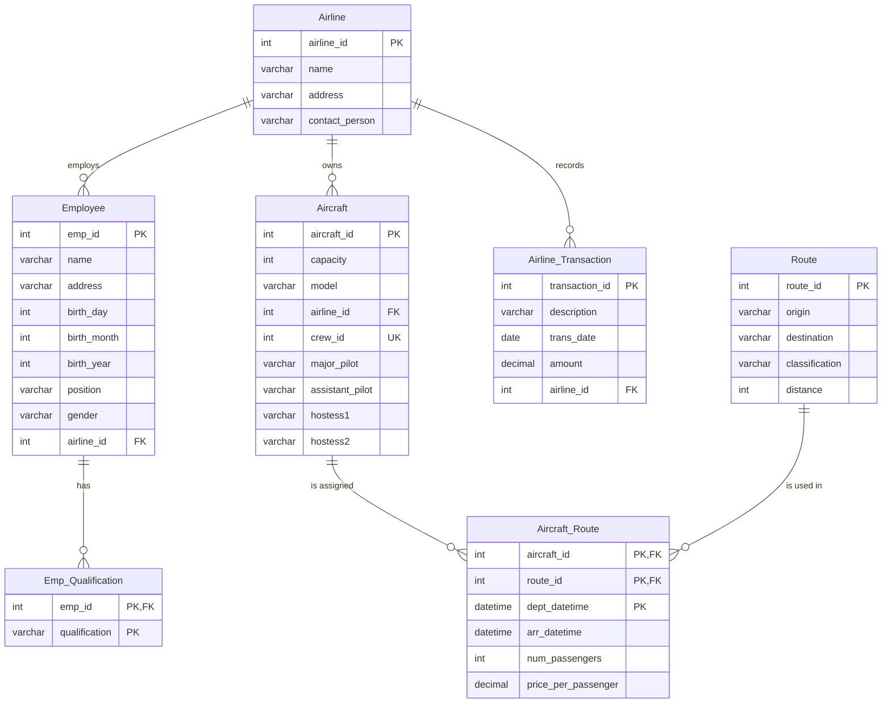

# Lab Problem 4: Airline (Mapping)

> Note from the case: an aircraft can use the same route on different dates.

## 1. Reading the ERD

### Entities

|Entity|Attributes|
|---|---|
|**Airline**|**ID** (PK), Name, Address, Contact Person, _(one attribute oval with no name, ignored)_|
|**Employee**|**ID** (PK), Name, Address, Birthday _(composite: Day, Month, Year)_, Position, Gender, Qualifications _(multi-valued)_|
|**Transaction**|**ID** (PK), Desc, Date, Amount|
|**Aircraft**|**ID** (PK), Capacity, Model|
|**Crew** _(weak entity)_|**Crew_ID**, Major pilot, Assistant pilot, Hostess 1, Hostess 2|
|**Route**|**ID** (PK), Origin, Destination, Classification, Distance|

### Relationships

|Relationship|Entities|Cardinality|Participation|Attributes|
|---|---|---|---|---|
|Works in|Airline - Employee|1:M|Airline: **total**, Employee: **total**|-|
|Owns|Airline - Aircraft|1:M|Airline: partial, Aircraft: **total**|-|
|Records|Airline - Transaction|1:M|Airline: partial, Transaction: **total**|-|
|Has _(identifying)_|Aircraft - Crew|1:1|**total on both sides**|-|
|Assigned|Aircraft - Route|M:N|partial / partial|`#pass`, `Price/pass`, `Dept DateTime`, `Arr DateTime`, `Time spent`|

## 2. Mapping steps

|#|ERD element|Rule applied|Result|
|---|---|---|---|
|0|`Has` (1:1, **total on both sides**)|**Pre-check:** both entities become **one table**|`Crew` columns are added to `Aircraft`|
|1|Entities Airline, Employee, Transaction, Aircraft, Route|Step 1: one table per entity|5 tables (Crew is inside Aircraft)|
|2|Composite `Employee.Birthday`|Step 1: keep only the parts|`birth_day`, `birth_month`, `birth_year`|
|3|Multi-valued `Employee.Qualifications`|Step 1: new table, PK = owner's PK + value|`Emp_Qualification`|
|4|`Works in` (1:M, many side = Employee, **total**)|Step 4: FK in the many side|`Employee.airline_id` (`NOT NULL`)|
|5|`Owns` (1:M, many side = Aircraft, **total**)|Step 4: FK in the many side|`Aircraft.airline_id` (`NOT NULL`)|
|6|`Records` (1:M, many side = Transaction, **total**)|Step 4: FK in the many side|`Airline_Transaction.airline_id` (`NOT NULL`)|
|7|`Assigned` (M:N) + its attributes|Step 5: new table, PK = both keys, and the attributes go in it|`Aircraft_Route`|
|8|Derived attribute `Time spent`|Not stored|Constraint file|

## 3. Final schema

(**bold** = PK, _italic_ = FK)

- **Airline** (**airline_id**, name, address, contact_person)
- **Employee** (**emp_id**, name, address, birth_day, birth_month, birth_year, position, gender, _airline_id_)
- **Emp_Qualification** (_**emp_id**_, **qualification**) PK = both columns together
- **Aircraft** (**aircraft_id**, capacity, model, _airline_id_, crew_id, major_pilot, assistant_pilot, hostess1, hostess2)
    - `crew_id` is `NOT NULL` and `UNIQUE`
- **Airline_Transaction** (**transaction_id**, description, trans_date, amount, _airline_id_)
- **Route** (**route_id**, origin, destination, classification, distance)
- **Aircraft_Route** (_**aircraft_id**_, _**route_id**_, **dept_datetime**, arr_datetime, num_passengers, price_per_passenger) PK = `aircraft_id` + `route_id` + `dept_datetime`

## 4. Constraint file

- `Employee.Birthday = birth_day + birth_month + birth_year`
- `Time spent = arr_datetime - dept_datetime` (derived, so it is calculated in queries and not stored)
- `arr_datetime` must be later than `dept_datetime`

## 5. Notes

- **Crew and Aircraft in one table:** `Crew` is a weak entity, but its identifying relationship `Has` is **1:1 and total on both sides**. The pre-check rule says such entities become **one table**.
- **Why `aircraft_id` is the PK (and not `crew_id`):** both are unique, so either could be the PK. I chose `aircraft_id` because the aircraft is the owner in the identifying relationship, and it is the key that other tables use (`Aircraft_Route`). `crew_id` stays as a `UNIQUE` column.
- **Why `dept_datetime` is in the PK of `Aircraft_Route`:** the same aircraft can use the same route on different dates, so `aircraft_id + route_id` alone would repeat.
- **Names:** `Transaction`, `Desc`, `Date` and `Model` (written `Mode` by mistake) are SQL words or typos. I used `Airline_Transaction`, `description`, `trans_date` and `model`.
- **The unnamed attribute** on `Airline` in the ERD is ignored. In a real project I would ask the system analyst.
