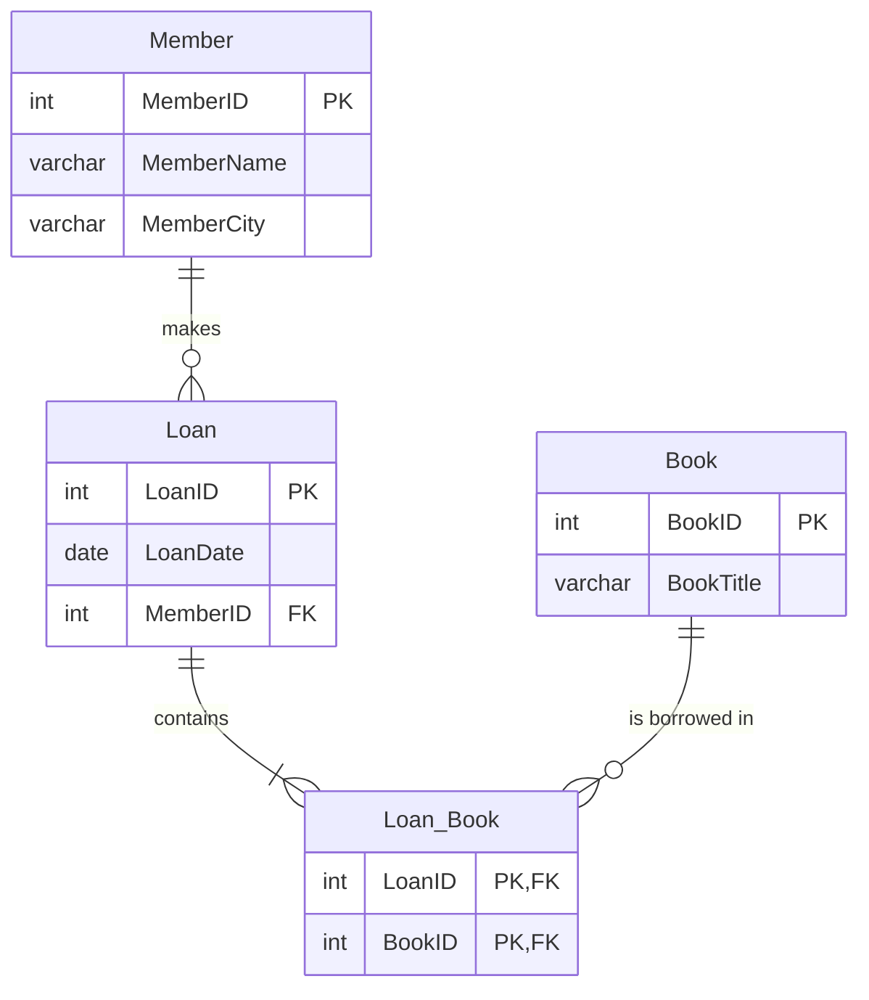

# Lecture 3: Joins, Built-in Functions and Normalization

> **In one sentence:** A join puts the data of two or more tables side by side by matching a foreign key with its primary key, and normalization is the process of splitting a messy table into smaller correct tables so the same fact is stored only once.

## Table of Contents

- Part 1: Joins
    - The sample data
    - Why joins
    - Cross join
    - Inner join (equi join)
    - Outer join
    - Self join
    - Joining more than two tables
    - Joins with DML
- Part 2: Built-in functions and more
    - ISNULL and COALESCE
    - CONVERT and CONCAT
    - LIKE
    - ORDER BY
- Part 3: Normalization
    - Two ways to design a database
    - Anomalies
    - Functional dependency
    - The normal forms
    - A full example
- Common Misunderstandings
---

# Part 1: Joins

## The sample data

All the results below come from these small tables.

**Employee** (`SuperSSN` is the supervisor, who is also an employee)

|SSN|FName|DeptNum|SuperSSN|
|---|---|---|---|
|101|Ahmed|1|`NULL`|
|102|Mona|1|101|
|103|Omar|2|101|
|104|Sara|2|102|
|105|Khaled|`NULL`|103|

**Department** (`MgrSSN` is the manager, who is an employee)

|DeptNum|Name|MgrSSN|MgrHireDate|
|---|---|---|---|
|1|HR|101|2009-05-01|
|2|IT|103|2012-03-15|
|3|Sales|102|2015-07-20|

> [!NOTE] Khaled has no department, and Sales has no employees. They are there on purpose, to show what the outer joins do.

## Why joins

Because of the design rules (mapping), the data of one idea is split across tables. A student's name is in `Student`, but the department name is in `Department`. To show both in one result we **join** the tables.

> [!TIP] **The table that holds the PK is the parent. The table that holds the FK is the child.** A join almost always matches `child.FK = parent.PK`.

SQL Server has these kinds of joins:

| Join                                 | Returns                                                              |
| ------------------------------------ | -------------------------------------------------------------------- |
| **Cross join**                       | Every row with every row (Cartesian product)                         |
| **Inner join**                       | Only the rows that **match**                                         |
| **Outer join** (left / right / full) | The matched rows **plus** the rows that have no match                |
| **Self join**                        | A table joined with **itself** (a technique, not a separate keyword) |

## Cross join

Every row of the first table is paired with every row of the second table.

```sql
SELECT FName, Name
FROM Employee, Department;
-- the same, with the keyword:
SELECT FName, Name
FROM Employee CROSS JOIN Department;
```

The **rows** multiply (not the columns): 5 employees x 3 departments = **15 rows**. With 1000 students and 20 departments you get 20,000 rows, and almost all of them are meaningless. So we rarely write it on purpose.

> [!NOTE] The `CROSS JOIN` keyword did not "replace" the comma. Both are valid. The explicit `JOIN` syntax came with the ANSI SQL-92 standard, and it makes the intention clear: nobody can think you forgot the `WHERE`.

## Inner join (equi join)

Returns **only the rows that match**. It is called an _equi join_ when the matching condition uses `=`, which is almost always the case (`FK = PK`).

### Old syntax: comma + WHERE

```sql
SELECT FName, Department.Name
FROM Employee, Department
WHERE Employee.DeptNum = Department.DeptNum;
```

|FName|Name|
|---|---|
|Ahmed|HR|
|Mona|HR|
|Omar|IT|
|Sara|IT|

Khaled (no department) and Sales (no employees) are **not** in the result. They have no match.

> [!IMPORTANT] If a column name exists in **both** tables (like `DeptNum`) you **must** write `table.column`, otherwise SQL Server gives _Ambiguous column name_. If the name exists in one table only (like `FName`), the table name is optional.

### New syntax: INNER JOIN ... ON

```sql
SELECT FName, Department.Name
FROM Employee INNER JOIN Department
     ON Employee.DeptNum = Department.DeptNum;
```

The result is the same. `ON` holds the joining condition.

### Which syntax should I use?

Both are **ANSI SQL** and both work in SQL Server. (The lecture said the old one is ANSI and the new one is T-SQL. That is not correct: `JOIN ... ON` is ANSI SQL-92, and the comma style is the older SQL-89.)

**Use `INNER JOIN ... ON`.** Reasons:

- The joining condition (`ON`) is separated from the filter (`WHERE`), so the query is easier to read.
- If you forget the condition, you get a **syntax error**. With the comma style you silently get a cross join.
- Outer joins can only be written with the `JOIN` keyword in modern SQL Server.

### More examples (manager of a department)

The manager is an employee, so `Department.MgrSSN` matches `Employee.SSN`.

```sql
-- The manager's name and the data of the department he manages
SELECT FName, Department.*
FROM Department INNER JOIN Employee
     ON SSN = MgrSSN;
```

|FName|DeptNum|Name|MgrSSN|MgrHireDate|
|---|---|---|---|---|
|Ahmed|1|HR|101|2009-05-01|
|Omar|2|IT|103|2012-03-15|
|Mona|3|Sales|102|2015-07-20|

- `Department.*` means **all the columns of Department only**.
- `SELECT FName, *` is also valid, but it prints the columns of **both** tables.

**Filtering and sorting** work as in the last lecture:

```sql
SELECT FName, Department.*
FROM Department INNER JOIN Employee
     ON SSN = MgrSSN
WHERE MgrHireDate >= '2010-01-01'
ORDER BY Department.Name;
```

### Condition in WHERE or in ON?

For an **inner** join it is the same, so these two return the same rows:

```sql
... INNER JOIN Employee ON SSN = MgrSSN WHERE MgrHireDate >= '2010-01-01'
... INNER JOIN Employee ON SSN = MgrSSN AND MgrHireDate >= '2010-01-01'
```

The second is common because `ON` can hold `AND`, `OR`, `IS NULL`, and so on. For an **outer** join it is **not** the same (see below).

## Outer join

An inner join throws away rows with no match. An outer join keeps the rows of one side (or both) even when they have no match, and fills the missing columns with `NULL`.

|Join|Keeps all rows of|
|---|---|
|`LEFT JOIN` (left outer)|the table **written before** the keyword (left)|
|`RIGHT JOIN` (right outer)|the table **written after** the keyword (right)|
|`FULL JOIN` (full outer)|**both** tables|

"Left" and "right" only mean the **position in the query**, not anything in the data.

```sql
-- All employees, with or without a department
SELECT FName, Department.Name
FROM Employee LEFT JOIN Department
     ON Department.DeptNum = Employee.DeptNum;
```

|FName|Name|
|---|---|
|Ahmed|HR|
|Mona|HR|
|Omar|IT|
|Sara|IT|
|Khaled|`NULL`|

```sql
-- All departments, with or without employees
SELECT FName, Department.Name
FROM Employee RIGHT JOIN Department
     ON Department.DeptNum = Employee.DeptNum;
```

The same four rows, but the last row is `NULL` + `Sales` (and Khaled is gone).

```sql
-- Everything from both sides
SELECT FName, Department.Name
FROM Employee FULL JOIN Department
     ON Department.DeptNum = Employee.DeptNum;
```

6 rows: the 4 matches + Khaled with `NULL` + Sales with `NULL`. **Full = left result + right result**, with the matched rows shown once.

### A very useful trick: find the rows with no match

```sql
-- Employees with NO department
SELECT FName
FROM Employee LEFT JOIN Department
     ON Department.DeptNum = Employee.DeptNum
WHERE Department.DeptNum IS NULL;
```

Result: `Khaled`. The `LEFT JOIN` adds the unmatched rows, and `WHERE ... IS NULL` keeps only them.

> [!WARNING] With an **outer** join, a condition in `WHERE` is applied **after** the join, so it can remove the `NULL` rows and turn your outer join back into an inner join. A condition in `ON` is applied **while** joining. When you mix filters with outer joins, think about which one you need.

## Self join

Used when a table has a **relation with itself** (a unary / recursive relation), like `Employee.SuperSSN` pointing to `Employee.SSN`.

The idea: use the **same table twice, with two different aliases**. One alias plays the child (the employee, who has the FK), the other plays the parent (the supervisor).

```sql
SELECT x.FName AS [Employee], y.FName AS [Supervisor]
FROM Employee x INNER JOIN Employee y
     ON y.SSN = x.SuperSSN;
```

|Employee|Supervisor|
|---|---|
|Mona|Ahmed|
|Omar|Ahmed|
|Sara|Mona|
|Khaled|Omar|

Ahmed has no supervisor, so the inner join drops him. With `LEFT JOIN` he stays with a `NULL` supervisor (5 rows).

> [!IMPORTANT]
> 
> - **There is no `SELF JOIN` keyword.** A self join is a normal `INNER JOIN` or `LEFT JOIN` on the same table.
> - The second "copy" exists only inside the query (in memory). Nothing is created in the database.
> - After you give a table an alias, you **must** use the alias. `x.FName` is right, `Employee.FName` is an error.
> - Any join type can be used, not only `INNER`.

## Joining more than two tables

Yes, you can. Example: the student name, the course name and the grade. The grade is in the `StudentCourse` table (the M:N table), so three tables are needed.

```sql
-- Old syntax
SELECT S.Name AS [Student name], C.Name AS [Course name], SC.Grade
FROM Student S, StudentCourse SC, Course C
WHERE S.Id = SC.Sid
  AND C.Id = SC.Cid;

-- JOIN syntax
SELECT S.Name AS [Student name], C.Name AS [Course name], SC.Grade
FROM Student S INNER JOIN StudentCourse SC
         ON S.Id = SC.Sid
     INNER JOIN Course C
         ON C.Id = SC.Cid;
```

|Student name|Course name|Grade|
|---|---|---|
|Ali|SQL|80|
|Ali|OOP|70|
|Mona|SQL|90|
|Omar|OOP|60|

- A `JOIN` combines **two things at a time**: the result so far and the next table. That is why you can chain as many as you need.
- **Rule: at least (number of tables - 1) join conditions.** 2 tables need 1, 3 tables need 2. (If a join uses a composite key, that one join needs more than one condition.)
- The `JOIN` syntax is easier to read, because each table comes with its own `ON`.

## Joins with DML

Joins are not only for `SELECT`. They also help `UPDATE`, `DELETE` and `INSERT`.

### UPDATE with a join

Without a join, **all** the grades change:

```sql
UPDATE StudentCourse SET Grade += 10;
```

To raise only the grades of the students who live in Cairo, the city is in another table, so we join:

```sql
UPDATE SC
SET    Grade += 10
FROM   Student S INNER JOIN StudentCourse SC
       ON S.Id = SC.Sid
WHERE  S.City = 'Cairo';
```

> [!WARNING] With a join, `UPDATE` must name the **alias** (`UPDATE SC`), and the join goes in `FROM`. If you write `UPDATE StudentCourse ... FROM Student S, StudentCourse SC`, SQL Server can treat the updated table and `SC` as two different things, and the update may touch **all** rows.

`Grade += 10` is short for `Grade = Grade + 10`.

### DELETE with a join

Same shape: delete the grades of the students who live in Giza.

```sql
DELETE SC
FROM   Student S INNER JOIN StudentCourse SC
       ON S.Id = SC.Sid
WHERE  S.City = 'Giza';
```

### INSERT with a join

`INSERT ... SELECT` copies the result of a query (it can be a join) into another table:

```sql
INSERT INTO GradeReport (StudentName, CourseName, Grade)
SELECT S.Name, C.Name, SC.Grade
FROM Student S INNER JOIN StudentCourse SC ON S.Id = SC.Sid
               INNER JOIN Course C         ON C.Id = SC.Cid;
```

---

# Part 2: Built-in functions and more

## ISNULL and COALESCE

Both replace a `NULL` with another value.

||`ISNULL(a, b)`|`COALESCE(a, b, c, ...)`|
|---|---|---|
|Arguments|exactly **2**|**any number** (a list, not an array)|
|Returns|`b` if `a` is `NULL`, else `a`|the **first value that is not `NULL`**|
|Standard|T-SQL only|ANSI SQL|
|If everything is `NULL`|`NULL`|`NULL`|

```sql
SELECT Name, ISNULL(Age, 0) AS Age FROM Student;          -- Omar's NULL becomes 0

SELECT FName,
       COALESCE(CAST(DeptNum AS VARCHAR(10)), CAST(SuperSSN AS VARCHAR(10)), 'No data') AS Info
FROM Employee;
```

> [!NOTE] `ISNULL` gives the result the **data type of the first argument**, so a long replacement text can be cut. `COALESCE` does not have this problem.

### `IS NULL` is not `ISNULL()`

||`x IS NULL`|`ISNULL(x, y)`|
|---|---|---|
|What it is|a **condition** (true / false)|a **function** (returns a value)|
|Used in|`WHERE`, `ON`|`SELECT` (and anywhere a value is allowed)|
|Job|**find** the rows with `NULL`|**replace** the `NULL` in the output|

```sql
SELECT Name FROM Student WHERE Age IS NULL;     -- only Omar
SELECT Name, ISNULL(Age, 0) FROM Student;       -- all the students, no NULL shown
```

## CONVERT and CONCAT

`CONVERT(type, value)` changes the data type. If the value is `NULL`, the result is `NULL`.

```sql
SELECT Name, CONVERT(VARCHAR(4), Age) AS AgeText FROM Student;
```

`+` joins texts, but **text + number is an error** (SQL Server tries to turn the text into a number), and **anything + NULL = NULL**:

```sql
SELECT Name + ' ' + Age FROM Student;                    -- error
SELECT Name + ' ' + CONVERT(VARCHAR(4), Age) FROM Student; -- works, but Omar's result is NULL
```

`CONCAT` is simpler: it converts every value to text and treats `NULL` as an **empty string**:

```sql
SELECT CONCAT(Name, ' ', Age) FROM Student;
```

The long way to get the same result:

```sql
SELECT ISNULL(Name, '') + ' ' + ISNULL(CONVERT(VARCHAR(4), Age), '') FROM Student;
```

(`ISNULL` needs two arguments, and the conversion goes inside it.)

## LIKE

`LIKE` searches for a **pattern** in text.

|Symbol|Meaning|
|---|---|
|`%`|any number of characters (**zero or more**)|
|`_`|**exactly one** character|
|`[abc]`|one character from the set|
|`[a-h]`|one character from the range|
|`[^a-h]`|one character **not** in the range|
|`[%]`, `[_]`|a **real** `%` or `_` (the symbol itself)|

The default collation is case-insensitive, so `'ah'` also matches `'Ah'`.

Test data: `Ahmed, Hanah, Zeina, a_b, axb, 100%, 50%off, Chair, Sahar`

| Pattern      | Meaning                                                                                      | Matches                           |
| ------------ | -------------------------------------------------------------------------------------------- | --------------------------------- |
| `'%ah%'`     | contains `ah`                                                                                | Ahmed, Hanah, Sahar               |
| `'ah%'`      | starts with `ah`                                                                             | Ahmed                             |
| `'_[_]_'`    | 3 characters, the middle one is a real `_`                                                   | a_b                               |
| `'%[%]'`     | ends with a real `%`                                                                         | 100%                              |
| `'%[%]%'`    | contains a real `%`                                                                          | 100%, 50%off                      |
| `'_[a-h]_%'` | any char, then a letter from a to h, then any char, then anything (so at least 3 characters) | Ahmed, Hanah, Zeina, Chair, Sahar |

## ORDER BY

|Question|Answer|
|---|---|
|Can I order by a column that is **not** in `SELECT`?|**Yes**. (Not when you use `SELECT DISTINCT`.)|
|Can I order by a **number**, like `ORDER BY 2`?|Yes: the 2nd column of the `SELECT` list. **Avoid it**: if someone changes the list, the order silently changes.|
|Can I order by **many columns**?|Yes: `ORDER BY DeptNum, FName`. It sorts by `DeptNum` first, and `FName` only breaks ties inside the same `DeptNum`.|

Each column can have its own direction. `ASC` (small to big) is the default:

```sql
SELECT FName, DeptNum
FROM Employee
ORDER BY DeptNum ASC, FName DESC;
```

---

# Part 3: Normalization

## Two ways to design a database

||ERD|Normalization|
|---|---|---|
|Direction|**Top-down**: from the business description to tables|**Bottom-up**: from existing tables / Excel sheets to better tables|
|Use it when|Building a new system, or adding big new features|You already have data, and it has duplication or is slow to maintain|

Normalization means: **restructure the current tables** so that each fact is stored in one place only. It usually splits one table into two or more tables linked by keys.

## Anomalies

An anomaly is a problem caused by duplicated data.

|Anomaly|Meaning|Example|
|---|---|---|
|**Insertion**|You cannot add a fact without adding unrelated data (or you must duplicate data)|You cannot add a new book until someone borrows it|
|**Deletion**|Deleting a row also deletes a fact you still need|Deleting the only loan of a member also deletes the member's data|
|**Modification**|One real change needs many row changes|A member moves to another city, so every loan row of that member must be updated. Miss one and the data disagrees|

## Functional dependency

> **A -> B** means: for every value of A there is exactly **one** value of B. "A determines B".

Example: `SSN -> FName` (an SSN gives one name), but `FName -> SSN` is false (two people can have the same name).

A table is **well designed** when every non-key column depends on **the key, the whole key, and nothing but the key**. Three kinds of dependency show how a column can break that:

|Type|Meaning|Where it can happen|
|---|---|---|
|**Full**|The column depends on the **whole** PK|This is the good one|
|**Partial**|The column depends on **part** of a **composite** PK|Only when the PK is composite|
|**Transitive**|The column depends on another **non-key** column, which depends on the PK (`PK -> A -> B`)|Any table|

## The normal forms

A normal form is a level of quality. We start from the raw table and fix one problem at a time.

|Form|Rule|What to do|
|---|---|---|
|**0NF**|The raw table, as we received it|(starting point)|
|**1NF**|Every cell is **atomic**: no multi-valued or composite values, no repeating groups|Split the repeating group into **rows** (or into a new table that carries the PK as an FK)|
|**2NF**|1NF + **no partial dependency**|Move the columns that depend on part of the key into their own table|
|**3NF**|2NF + **no transitive dependency**|Move the columns that depend on a non-key column into their own table|

> [!NOTE]
> 
> - **2NF only matters when the PK is composite.** A table with a single-column PK that is in 1NF is already in 2NF.


## A full example

A library loan table (0NF). A loan can have up to two books, stored in repeating columns:

|LoanID|LoanDate|MemberID|MemberName|MemberCity|Book1_ID|Book1_Title|Book2_ID|Book2_Title|
|---|---|---|---|---|---|---|---|---|

### To 1NF: remove the repeating group

One row for each book in a loan. The PK is now **composite**: `(LoanID, BookID)`.

|LoanID|BookID|LoanDate|MemberID|MemberName|MemberCity|BookTitle|
|---|---|---|---|---|---|---|

This table has all three anomalies. The member's data is repeated in every row of his loans.

### To 2NF: remove partial dependencies

With PK = `(LoanID, BookID)`:

- `LoanDate, MemberID, MemberName, MemberCity` depend on `LoanID` only (**partial**).
- `BookTitle` depends on `BookID` only (**partial**).
- Nothing depends on the whole key, so the link table stays with the key only.

Result: three tables.

- **Loan** (**LoanID**, LoanDate, MemberID, MemberName, MemberCity)
- **Book** (**BookID**, BookTitle)
- **Loan_Book** (_**LoanID**_, _**BookID**_)

### To 3NF: remove transitive dependencies

In `Loan`: `LoanID -> MemberID -> MemberName, MemberCity`. The name and the city depend on `MemberID`, which is not the key. (**transitive**)

Result: four tables.

- **Member** (**MemberID**, MemberName, MemberCity)
- **Loan** (**LoanID**, LoanDate, _MemberID_)
- **Book** (**BookID**, BookTitle)
- **Loan_Book** (_**LoanID**_, _**BookID**_)

(**bold** = PK, _italic_ = FK)



The anomalies are gone: a new book can exist without a loan (insertion), deleting a loan does not delete the member (deletion), and a city change is one update in one row (modification).

### How to normalize any table (checklist)

1. Find the **PK** (and ask: is it composite?).
2. Write the **functional dependencies** of every column.
3. **1NF:** are there repeating groups, multi-valued or composite columns? Fix them.
4. **2NF:** any column that depends on only part of the composite PK? Move it out.
5. **3NF:** any column that depends on a non-key column? Move it out.
6. Make sure the PK of each new table is clear, and the FKs link the tables back.

---

# Quick Revision

- **Parent** = holds the PK. **Child** = holds the FK. Join on `FK = PK`.
- **Cross** = all combinations. **Inner** = matches only. **Left / Right / Full** = matches + the unmatched rows of one side / both. **Self** = same table, two aliases.
- Use `JOIN ... ON`. Conditions of an inner join: `ON` or `WHERE`. Outer join: be careful.
- `ISNULL(a, b)` (2 args), `COALESCE(...)` (first non-null), `CONVERT`, `CONCAT` (NULL becomes empty).
- `LIKE`: `%` many, `_` one, `[a-h]` range, `[%]` a real percent.
- `ORDER BY` a column not in `SELECT` is allowed. Many columns: the first one decides, the next ones break ties.
- Normalization: **1NF** atomic, **2NF** no partial dependency, **3NF** no transitive dependency. Goal: no anomalies.
---