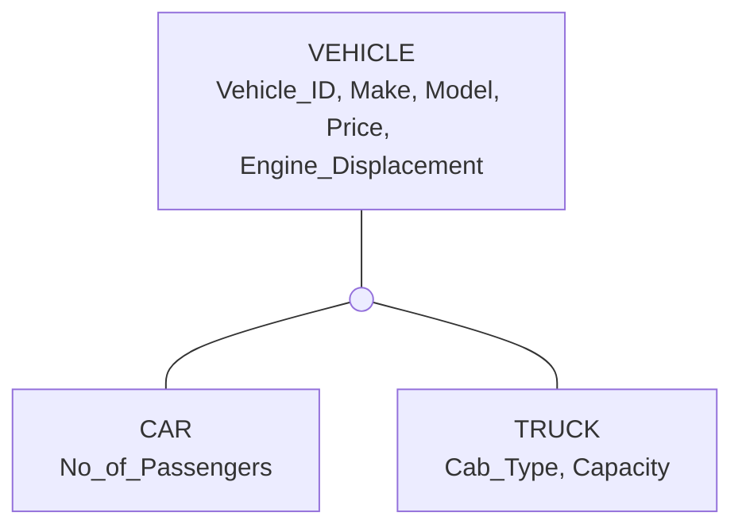
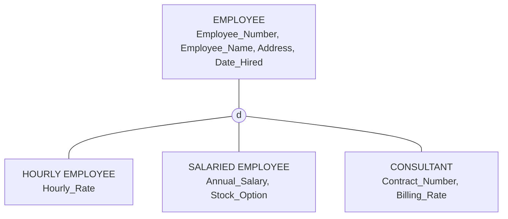
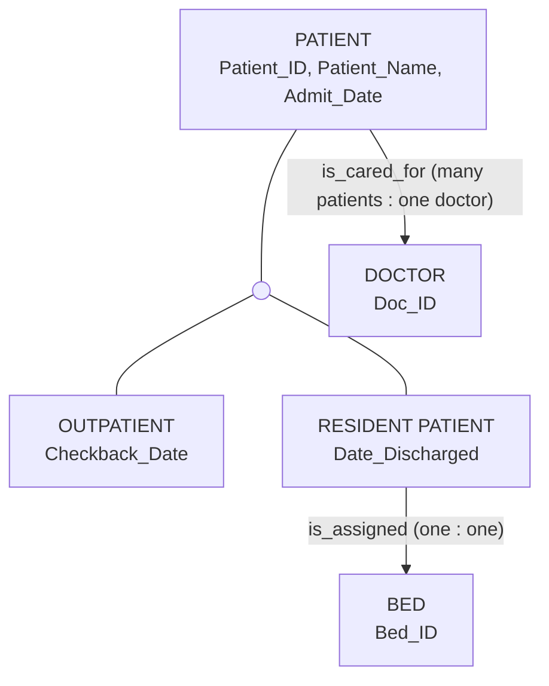
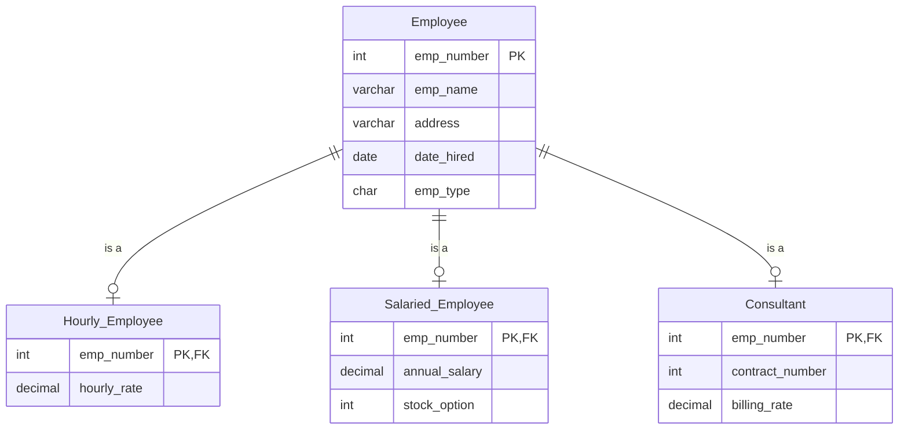
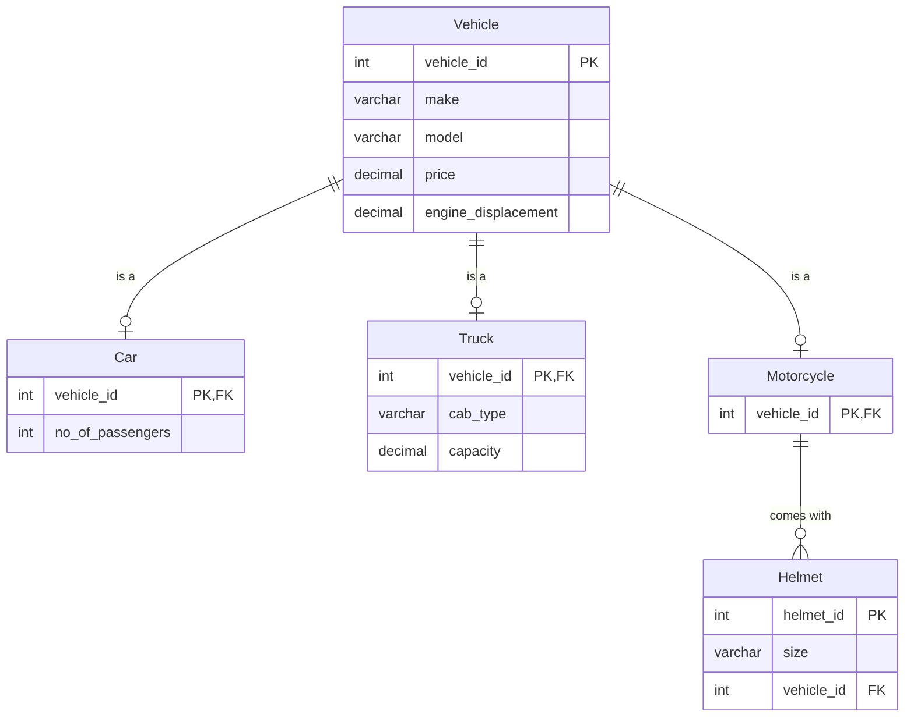

# Lecture 4: Aggregates, Grouping, Subqueries, Set Operators and EERD

> **In one sentence:** Aggregate functions turn many rows into one value, `GROUP BY` does that once for each group, subqueries and set operators let us combine queries, and the EERD adds "is-a" hierarchies (supertype / subtype) to the ERD.
---

# Part 1: Aggregate functions

## What is an aggregate function

Until now every query returned values taken from the rows. An **aggregate function** reads **many rows** and returns **one value**.

|Function|Returns|Works on|
|---|---|---|
|`COUNT(...)`|how many|any column, or `*`|
|`SUM(col)`|the total|numbers|
|`AVG(col)`|the average|numbers|
|`MIN(col)`|the smallest|numbers, text, dates|
|`MAX(col)`|the biggest|numbers, text, dates|

```sql
SELECT SUM(salary) FROM Instructor;                  -- 37000 (one cell, and the column has no name)
SELECT SUM(salary) AS [Total salary] FROM Instructor;   -- AS gives it a name

SELECT MIN(salary) AS [Min value], MAX(salary) AS [Max value]
FROM Instructor;
```

> [!NOTE] The result column has no name because it comes from a function, not from a column. Use `AS` to name it.

## COUNT and NULL

> **Aggregate functions ignore `NULL`.** (`COUNT(*)` is the exception: it counts rows.)

|Expression|Counts|
|---|---|
|`COUNT(*)`|all the **rows**|
|`COUNT(col)`|the rows where `col` is **not NULL**|
|`COUNT(DISTINCT col)`|the different non-NULL values|

```sql
SELECT COUNT(*), COUNT(st_id), COUNT(st_fname), COUNT(st_age)
FROM Student;
-- 6, 6, 6, 5   (one student has no age)
```

So for every column: `COUNT(*) >= COUNT(col)`. They are **equal** when the column never has `NULL`. A primary key can never be `NULL`, so `COUNT(*) = COUNT(id)`. A column that allows `NULL` can be smaller.

## AVG, NULL and integer division

`AVG(col) = SUM(col) / COUNT(col)`. Both ignore the `NULL` rows, so **AVG is the average of the known values**.

Employee salaries: 6 known values (total 35500) and 2 `NULL`.

|Expression|Result|Meaning|
|---|---|---|
|`AVG(salary)`|5916.67|average of the 6 known salaries|
|`SUM(salary) / COUNT(*)`|4437.5|the 2 unknown salaries are counted as 0|
|`AVG(ISNULL(salary, 0))`|4437.5|the same thing, written shorter|

> [!IMPORTANT] Which one is "right" depends on what `NULL` means.
> 
> - **Unknown value** (the salary exists but we do not know it): use `AVG(salary)`. Treating it as 0 pulls the average down.
> - **No value, so really zero** (for example, no bonus): `ISNULL(bonus, 0)` is right.
> 
> The lecture note said the plain `AVG` is "wrong". It is not wrong. It answers a different question.

Also, `ISNULL` is **not** "faster than two aggregates". SQL Server computes `SUM` and `COUNT` together in one pass. The only gain is shorter code, and the meaning changes (NULL becomes 0).

> [!WARNING] **`AVG` of an `INT` column returns an `INT`** (the decimals are cut). Ages 20, 22, 25, 18, 21 have the average 21.2:
> 
> ```sql
> SELECT AVG(st_age)       FROM Student;   -- 21
> SELECT AVG(st_age * 1.0) FROM Student;   -- 21.2
> ```
> 
> The same happens with `SUM(age) / COUNT(*)`: it is an integer division. Multiply by `1.0` (or `CAST` to `DECIMAL`) when you need the decimals.

**Mixing** an aggregate and a normal column in `SELECT` is an error, unless the column is in `GROUP BY`:

```sql
SELECT emp_name, SUM(salary) FROM Employee;
-- error: Column 'emp_name' is invalid in the select list because it is not
--        contained in either an aggregate function or the GROUP BY clause.
```

---

# Part 2: GROUP BY, WHERE and HAVING

## GROUP BY

`GROUP BY` splits the rows into groups, and the aggregate is calculated **once for each group**.

> **Rule:** every column in `SELECT` that is **not inside an aggregate** must be in `GROUP BY`.

```sql
-- The number of employees in each city
SELECT city, COUNT(emp_id) AS employees
FROM Employee
GROUP BY city;
```

|city|employees|
|---|---|
|Cairo|4|
|Giza|3|
|Alex|1|

```sql
-- The sum of the salaries in each department
SELECT dept_id, SUM(salary) AS total_salary
FROM Employee
GROUP BY dept_id;
```

|dept_id|total_salary|
|---|---|
|10|11000|
|20|15000|
|30|9500|
|`NULL`|`NULL`|

- All the `NULL` values go into **one group** (the last row: Youssef has no department, and his salary is `NULL`).
- The opposite of the rule is **not** required: you may `GROUP BY` a column that is not in `SELECT` (you just will not see which group is which).

### Two tables and the rule

```sql
SELECT d.dept_id, d.dept_name, SUM(e.salary) AS total_salary
FROM Employee e INNER JOIN Department d
     ON d.dept_id = e.dept_id
GROUP BY d.dept_id, d.dept_name;
```

The groups are really decided by `dept_id` alone (one id has one name), but SQL Server does not know that, so `dept_name` must also be in `GROUP BY`.

Notice `d.dept_id`: the column exists in both tables, so `GROUP BY dept_id` gives _Ambiguous column name_.

> [!NOTE] Group by a column that has **repeated values** (city, department). Grouping by a primary key is allowed, but it makes one group for each row, so it is pointless. (`GROUP BY *` is not valid SQL.)

## Grouping by many columns

It is **not** "group by the first, then group the result by the second". It is **one grouping**: every different **combination** of the columns is one group.

```sql
SELECT dept_id, gender, COUNT(*) AS employees
FROM Employee
GROUP BY dept_id, gender;
```

|dept_id|gender|employees|
|---|---|---|
|10|F|1|
|10|M|1|
|20|F|1|
|20|M|2|
|30|F|2|
|`NULL`|M|1|

Six different pairs, so six groups. The order of the columns inside `GROUP BY` does not change the groups.

## WHERE vs HAVING

||`WHERE`|`HAVING`|
|---|---|---|
|Filters|**rows**|**groups**|
|When|**before** `GROUP BY`|**after** `GROUP BY`|
|Can use an aggregate|**No**|**Yes**|

- `WHERE` removes rows first, so only the rows that pass are grouped. (A group disappears completely if all its rows fail.)
- `HAVING` keeps or removes whole groups, using a condition on the group (`SUM`, `COUNT`, ...).

```sql
-- WHERE: count only the Cairo employees in each department
SELECT dept_id, COUNT(*) AS employees
FROM Employee
WHERE city = 'Cairo'
GROUP BY dept_id;

-- HAVING: keep only the departments whose total salary is more than 10000
SELECT dept_id, SUM(salary) AS total_salary
FROM Employee
GROUP BY dept_id
HAVING SUM(salary) > 10000;
```

```sql
SELECT * FROM Employee WHERE salary > AVG(salary);
-- error: An aggregate may not appear in the WHERE clause
```

> [!TIP] Use `WHERE` for conditions on single rows, because it filters **early** (less data to group). Use `HAVING` only for conditions on aggregates.

Questions from the lecture:

|Question|Answer|
|---|---|
|Can `HAVING` use an aggregate that is **not** in `SELECT`?|**Yes.** `SELECT dept_id FROM Employee GROUP BY dept_id HAVING COUNT(*) > 1 AND AVG(salary) > 5500`|
|Can I write `SELECT` with `HAVING` and **no** `GROUP BY`?|**Yes.** The whole table is one group: `SELECT COUNT(*) FROM Employee HAVING COUNT(*) > 5`|
|Can I use a `HAVING` on a column that is not an aggregate?|Only a column that is in `GROUP BY`, but it is better in `WHERE`|

A full query, with every clause in its fixed order:

```sql
SELECT   dept_id, COUNT(*) AS employees, SUM(salary) AS total_salary
FROM     Employee
WHERE    dept_id IS NOT NULL
GROUP BY dept_id
HAVING   COUNT(*) >= 2
ORDER BY total_salary DESC;
```

## Execution order

SQL runs the clauses in a different order from how we write them:

|Step|Clause|Note|
|---|---|---|
|1|`FROM` / `JOIN ... ON`|build the rows|
|2|`WHERE`|filter rows|
|3|`GROUP BY`|make the groups|
|4|`HAVING`|filter groups|
|5|`SELECT`|choose the columns, create the aliases|
|6|`ORDER BY`|sort|

That is why a `SELECT` alias works in `ORDER BY` (step 6) but **not** in `WHERE`, `GROUP BY` or `HAVING` (they run before step 5).

---

# Part 3: Subqueries

## What is a subquery

A **subquery** is a query inside another query. The result of the inner query is used as an input by the outer query. It can be used with `SELECT`, `INSERT`, `UPDATE` and `DELETE`.

**Problem:** the students younger than the average age.

```sql
SELECT * FROM Student WHERE st_age < AVG(st_age);   -- error: aggregate in WHERE
```

`HAVING` cannot help here: it needs `GROUP BY`, and a grouped query cannot show all the columns of the rows. The subquery solves it:

```sql
SELECT *
FROM Student
WHERE st_age < (SELECT AVG(st_age) FROM Student);
```

The inner query runs first and returns **one value**, then the outer query compares with it.

|Kind|Returns|Used with|
|---|---|---|
|**Scalar** subquery|one value|`=`, `<`, `>`, ... (also in `SELECT`)|
|**Multi-value** subquery|one column, many rows|`IN`, `NOT IN`|
|**Correlated** subquery|uses a value from the outer row|`EXISTS` and others|

> [!WARNING]
> 
> - A scalar subquery that returns **more than one row** gives an error. Use `IN` instead of `=`.
> - Students whose age is `NULL` never appear: `NULL < 21` is never true.


## IN, NOT IN and EXISTS

**The departments that have students:**

```sql
SELECT dept_name
FROM Department
WHERE dept_id IN (SELECT dept_id FROM Student WHERE dept_id IS NOT NULL);
```

Result: HR, IT, Sales (each **once**).

- `DISTINCT` is **not needed** inside `IN`: it only asks "is the value in the list?".
- `DISTINCT` is a keyword, not a function. Write `DISTINCT dept_id`, not `DISTINCT(dept_id)`.

`EXISTS` asks "is there at least one row?" (the `SELECT 1` is a convention: the value does not matter):

```sql
SELECT dept_name
FROM Department d
WHERE EXISTS (SELECT 1 FROM Student s WHERE s.dept_id = d.dept_id);
```

> [!CAUTION] **The `NOT IN` trap.** If the subquery returns even **one `NULL`**, `NOT IN` returns **no rows at all**.
> 
> ```sql
> -- Zeina has no department (NULL), so this returns 0 rows, although Legal has no students:
> SELECT dept_name FROM Department
> WHERE dept_id NOT IN (SELECT dept_id FROM Student);
> 
> -- Fix 1: remove the NULLs         ... NOT IN (SELECT dept_id FROM Student WHERE dept_id IS NOT NULL)
> -- Fix 2: use NOT EXISTS (safe)    ... WHERE NOT EXISTS (SELECT 1 FROM Student s WHERE s.dept_id = d.dept_id)
> ```
> 
> (`x NOT IN (1, NULL)` means `x <> 1 AND x <> NULL`, and `x <> NULL` is never true.)

## Subquery or join, and the optimizer

The same question with a join:

```sql
SELECT dept_name
FROM Department INNER JOIN Student
     ON Department.dept_id = Student.dept_id;
```

|Version|Rows|
|---|---|
|`IN (subquery)`|HR, IT, Sales (**3**)|
|join|HR, HR, IT, IT, Sales (**5**): a department repeats for each student|
|join + `DISTINCT`|HR, IT, Sales (3)|


**What is the optimizer?** In SQL we say **what** we want, not **how** to get it. The **query optimizer** is the part of SQL Server that decides the _how_:

1. It reads the query and thinks of several equivalent ways to run it (which index, which table first, which join algorithm, or a rewritten query).
2. It estimates the **cost** of each way, using **statistics** about the data (how many rows, how the values are spread).
3. It picks the cheapest one. This choice is the **execution plan**.

For subqueries: the optimizer often **rewrites** `IN (subquery)` and `EXISTS` into a _semi join_ ("does a match exist?"), so they often get the **same plan** as the join. The lecture said the subquery is "very slow". That is a good habit to be careful, but not a safe rule today. Some real problems:

- A **correlated** subquery inside the `SELECT` list may run once for each row.
- `NOT IN` with `NULL` has different meaning, and is harder to optimize.
- The optimizer can only rewrite when the result stays **the same**. `IN` and a plain join are not the same when there are duplicates, so it cannot swap them blindly.

## Subqueries with DML

```sql
-- DELETE: remove the course rows (enrollments) of the students who live in Cairo
DELETE FROM St_Course
WHERE st_id IN (SELECT st_id FROM Student WHERE address = 'Cairo');
```

It deletes the **enrollment rows** in `St_Course`, not the courses themselves (a course is in another table).

```sql
-- UPDATE: raise by 10% the salary of the employees who work in the IT department
UPDATE Employee
SET    salary = salary * 1.1
WHERE  dept_id IN (SELECT dept_id FROM Department WHERE dept_name = 'IT');

-- INSERT ... SELECT: copy the employees who earn more than the average to another table
INSERT INTO High_Paid (emp_id, emp_name, salary)
SELECT emp_id, emp_name, salary
FROM Employee
WHERE salary > (SELECT AVG(salary) FROM Employee);
```

The subquery is the easy way to say "the rows that are related to something in another table", without a join (day 3 showed the join version of `UPDATE` and `DELETE`).

---

# Part 4: Set operators

They combine the results of **two queries** (not two tables).

|Operator|Returns|Duplicates|
|---|---|---|
|`UNION ALL`|the first result, with the second one **under** it|**kept**|
|`UNION`|the same, then removes duplicates|**removed**|
|`INTERSECT`|the rows that exist in **both** results|removed|
|`EXCEPT`|the rows in the **first** result that are **not** in the second|removed|

**Rules:**

- Both queries must have the **same number of columns**.
- The columns in the same position must have **compatible data types** (not necessarily the same type, but SQL Server must be able to convert one to the other).
- The **column names** come from the **first** query.
- `ORDER BY` is written **once, at the very end**.
- For `UNION`, `INTERSECT` and `EXCEPT`, two `NULL` values are treated as **equal** (unlike `=` in `WHERE`).

Student names: Ali, Mona, Omar, Sara, Zeina, Ali. Instructor names: Mona, Hassan, Nadia, Sara.

```sql
SELECT st_fname AS name FROM Student
UNION ALL
SELECT inst_name FROM Instructor;                 -- 10 rows (6 + 4, "Ali" twice)

SELECT st_fname AS name FROM Student
UNION
SELECT inst_name FROM Instructor;                 -- 7 rows: Ali, Hassan, Mona, Nadia, Omar, Sara, Zeina

SELECT st_fname FROM Student
INTERSECT
SELECT inst_name FROM Instructor;                 -- Mona, Sara

SELECT st_fname FROM Student
EXCEPT
SELECT inst_name FROM Instructor;                 -- Ali, Omar, Zeina
```

> [!NOTE]
> 
> - `UNION` is slower than `UNION ALL` because SQL Server must find and remove the duplicates. Use `UNION ALL` when you know there are none, or you want them.
> - The lecture note said these operators "sort". They remove duplicates, and as a side effect the rows often come out sorted, but that is **not guaranteed**. Add `ORDER BY` if you need an order.
> - `EXCEPT` depends on the order: `A EXCEPT B` is not `B EXCEPT A` (above: Ali, Omar, Zeina; reversed: Hassan, Nadia).
> - `INTERSECT` is evaluated before `UNION` and `EXCEPT` when you mix them. Use brackets.

---

# Part 5: The parent-child rule

A foreign key keeps the data consistent (**referential integrity**). The default rule is:

> **You cannot delete a parent row, or change its key, while it still has children.**

```sql
DELETE FROM Department WHERE dept_id = 20;
-- error 547: The DELETE statement conflicted with the REFERENCE constraint ...

UPDATE Department SET dept_id = 200 WHERE dept_id = 20;
-- error 547 as well
```


There are two ways to deal with it.

### 1. Manually: write the statements in the right order


|Goal|Steps|
|---|---|
|**Delete** a parent|1) delete its children, then 2) delete the parent (if the children have their own children, start from the deepest level)|
|**Change** a parent key|1) insert the new parent row, 2) `UPDATE` all the children to the new key, 3) delete the old parent row|

```sql
-- change the key 20 to 200
INSERT INTO DeptA (dept_id, dept_name) VALUES (200, 'IT');
UPDATE EmpA SET dept_id = 200 WHERE dept_id = 20;
DELETE FROM DeptA WHERE dept_id = 20;
```

### 2. Automatically: referential actions on the foreign key
*LATER*

---

# Part 6: More built-in functions

|Function|What it does|Example|
|---|---|---|
|`GETDATE()`|the **date and time** now (server time)|`SELECT GETDATE();`|
|`CAST(GETDATE() AS DATE)`|the date part only|`2026-11-20`|
|`YEAR(date)` / `MONTH(date)` / `DAY(date)`|one part of a date, as a number|`YEAR(CAST('2026-11-20' AS DATE))` gives `2026`|
|`SUBSTRING(text, start, length)`|part of a text. The **first character is position 1**|`SUBSTRING('Ahmed', 1, 3)` gives `Ahm`|
|`DB_NAME()`|the name of the **current database**|`Day4Demo`|
|`SUSER_NAME()`|the **login name** you connected to the server with|`sa`|
|`CONVERT(type, value, style)`|change the type. For dates the style is the format|`CONVERT(VARCHAR(10), GETDATE(), 103)` gives `20/11/2026`|

From the earlier lectures: the aggregate functions, `ISNULL`, `COALESCE`, `CONCAT`, `CONVERT`.


> [!NOTE]
> 
> - `SUBSTRING` in SQL Server needs all 3 arguments (the length is required).
> - `SUSER_NAME()` is the **server login**. The user inside the database is `USER_NAME()`. They can be different.

---

# Part 7: EERD (Enhanced ERD)

## Why EERD

In the ERD we have several entities that share many attributes. Look at these three:

|CAR|TRUCK|MOTORCYCLE|
|---|---|---|
|Vehicle_ID, Make, Model, Price, Engine_Displacement, **No_of_Passengers**|Vehicle_ID, Make, Model, Price, Engine_Displacement, **Cab_Type, Capacity**|Vehicle_ID, Make, Model, Price, Engine_Displacement|

Most of the attributes are **repeated** in every entity. The EERD fixes this by pulling the shared part up into a **supertype** and keeping only the special part in each **subtype**.

## Supertype and subtype

|Term|Meaning|Example|
|---|---|---|
|**Supertype**|A general entity type that has a relationship with one or more subtypes|`VEHICLE`, `EMPLOYEE`, `PATIENT`|
|**Subtype**|A subgroup of the supertype, with attributes that are **different from the other subgroups**|`CAR`, `TRUCK`, `HOURLY EMPLOYEE`|
|**Inheritance**|A subtype **inherits all the attributes (and relationships)** of its supertype|A `CAR` has Make and Model without redrawing them|

Two facts to remember:

1. The relation between them is **"is a"**: a car **is a** vehicle.
2. **An instance of a subtype is also an instance of the supertype.** One real car is **one** row in `VEHICLE` and also a row in `CAR`.

**Notation:** the supertype box, a **circle** under it, and the subtype boxes under the circle (the small curved symbol on each line points toward the supertype). The circle can contain `d` or `o` (see constraints).



## Generalization and specialization

They are the same hierarchy seen from two directions.

||Direction|How you get there|
|---|---|---|
|**Generalization**|bottom-up|You have several entities (`CAR`, `TRUCK`, ...) with **common attributes**, so you create a supertype (`VEHICLE`) and move the common attributes into it|
|**Specialization**|top-down|You have one entity (`EMPLOYEE`) and notice groups with **their own attributes**, so you create subtypes for them|

Second example (specialization): every employee has an employee number, name, address and hire date. But each kind of employee also has its own data:



## Where do attributes and relationships go

|What|Where to draw it|
|---|---|
|An attribute **shared by all** the subtypes|in the **supertype**|
|An attribute that belongs to **one** subtype only|in that **subtype**|
|A relationship that **all** the subtypes take part in|at the **supertype** level|
|A relationship that **only one** subtype takes part in|at the **subtype** level|
|A subtype that has **no own attributes** (and no own relationships)|**not drawn** (it is just a vehicle)|

Hospital example:



- `is_cared_for` is drawn at the **supertype**: **both** kinds of patient are cared for by a responsible doctor.
- `is_assigned` is drawn at the **subtype**: **only resident patients** get a bed. An outpatient never has one.

## Constraints

Two independent questions describe a hierarchy.

### 1. Completeness: must every supertype instance be in a subtype?

|Rule|Drawn as|Meaning|Example|
|---|---|---|---|
|**Total** specialization|**double line** from the supertype to the circle|Every instance **must** belong to at least one subtype|A patient must be an outpatient or a resident patient|
|**Partial** specialization|**single line**|An instance **may** belong to no subtype|A vehicle can be a car, a truck, or neither|

### 2. Disjointness: can an instance be in more than one subtype?

|Rule|Letter in the circle|Meaning|Example|
|---|---|---|---|
|**Disjoint**|`d`|**At most one** subtype|A patient is an outpatient **or** resident, never both|
|**Overlap**|`o`|**One or more** subtypes|An employee can be both salaried and a consultant|

> [!TIP] **Completeness = "at least one?"** (double or single line). **Disjointness = "how many at most?"** (`d` or `o`). Do not mix them.

The two rules combine into four cases:

||Disjoint (`d`)|Overlap (`o`)|
|---|---|---|
|**Total** (double line)|exactly **one** subtype (patient: outpatient or resident)|**one or more** subtypes (employee: salaried and/or consultant, and nothing else)|
|**Partial** (single line)|**zero or one** subtype (vehicle: car or truck or neither)|**zero or more** subtypes (a person can be a student, an employee, both or none)|

## Subtype discriminator

The **discriminator** is an attribute **in the supertype** that tells which subtype an instance belongs to.

|Hierarchy|Discriminator|Example|
|---|---|---|
|**Disjoint**|one **simple** attribute with a value for each subtype|`Employee_Type` = `H` (hourly), `S` (salaried), `C` (consultant)|
|**Overlap**|one **composite** attribute with a **yes / no** part for each subtype|`Type` = (`Salary?` = Y/N, `Consultant?` = Y/N)|

With a disjoint hierarchy one value is enough (one subtype at most). With overlap you need a flag for each subtype, because an employee can be several at once.

## Mapping supertype and subtype to tables

The slide ends with the mapping of the Employee example. The rules:

|#|Rule|
|---|---|
|1|The **supertype** becomes a table: its PK, the shared attributes, and the **discriminator** column|
|2|Each **subtype** becomes a table: its own attributes, and a PK that is **the supertype's PK** (it is also a **foreign key** to the supertype table)|
|3|A **relationship** is mapped with the normal rules (day 2), from the table of the entity where it is drawn. A subtype-level relationship uses the **subtype table**|

```sql
CREATE TABLE Employee (
    emp_number   INT          PRIMARY KEY,
    emp_name     VARCHAR(50)  NOT NULL,
    address      VARCHAR(100),
    date_hired   DATE,
    emp_type     CHAR(1)      NOT NULL CHECK (emp_type IN ('H', 'S', 'C'))   -- the discriminator
);

CREATE TABLE Hourly_Employee (
    emp_number   INT           PRIMARY KEY REFERENCES Employee(emp_number),  -- PK and FK together
    hourly_rate  DECIMAL(8,2)
);
CREATE TABLE Salaried_Employee (
    emp_number    INT            PRIMARY KEY REFERENCES Employee(emp_number),
    annual_salary DECIMAL(10,2),
    stock_option  INT
);
CREATE TABLE Consultant (
    emp_number       INT           PRIMARY KEY REFERENCES Employee(emp_number),
    contract_number  INT,
    billing_rate     DECIMAL(8,2)
);
```



Because the PK of a subtype is also the FK, each employee has **at most one** row in each subtype table (the relation is 1 : 0..1).

**What about the constraints?**

|Constraint|In the tables|
|---|---|
|**Disjoint**|one discriminator column (`emp_type`) with one value|
|**Overlap**|one flag column for each subtype instead (for example `is_salaried`, `is_consultant`)|
|**Total**|every supertype row must have a row in a subtype table. A plain foreign key cannot force this (it points the other way), so it goes in the **constraint file** (or a trigger / the application)|
|**Partial**|nothing to do|

## A subtype with no own attributes but its own relationship


> _If `MOTORCYCLE` has the same attributes as `VEHICLE`, but it also has a relationship that the other subtypes do not have, what do we do?_

**Draw it as a subtype.** The rule "no attributes of its own, so do not draw it" is only true when the subtype has **no unique attributes and no unique relationships**.

Why:

- A relationship drawn at the **supertype** means **every** vehicle takes part in it, including cars and trucks. That is wrong.
- The only way to say "**only motorcycles**" is to draw `MOTORCYCLE` as a subtype and attach the relationship to it.
- The subtype box can be **empty of attributes**. It inherits everything and only carries the relationship.

Example: only motorcycles are linked to a `HELMET`.



`Motorcycle` has only the key (inherited from `Vehicle`), and `Helmet.vehicle_id` points to `Motorcycle`, so a helmet can never belong to a car.

---