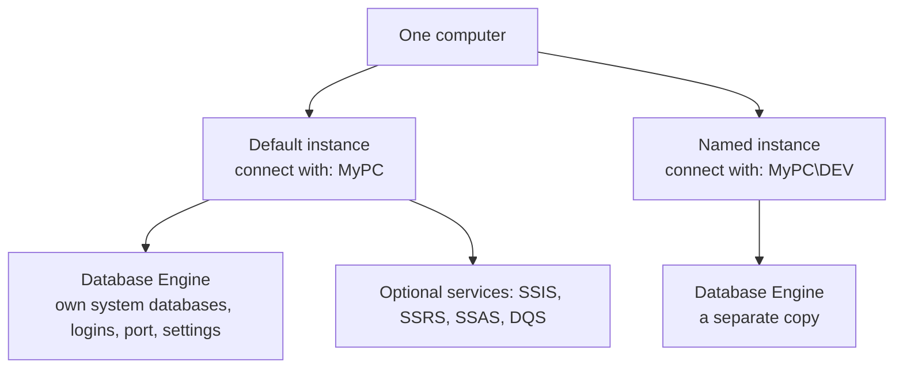
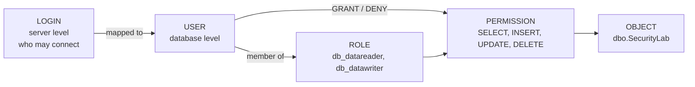

# Lecture 5: TOP, Ranking Functions, Data Types, CASE, SQL Server Architecture and Security

> **In one sentence:** We learn to take only some rows (`TOP`), number and rank rows (ranking functions), copy data into new tables (`SELECT INTO`), choose the right data types, write conditions inside queries (`CASE`), and then look at how SQL Server is installed (instances and services) and how a user is allowed in (logins, users, roles, permissions).
---

# Part 1: TOP, WITH TIES and NEWID

## TOP

`TOP (n)` returns only the **first n rows** of the result.

```sql
SELECT TOP(2) St_Name
FROM Student
WHERE City = 'Cairo';
```

> [!WARNING] `TOP` **without `ORDER BY`** returns _any_ n rows. SQL Server does not promise which ones. To get "the first", "the oldest" or "the highest", you must add `ORDER BY`.

```sql
SELECT TOP(2) St_Name, Age
FROM Student
ORDER BY Age DESC;               -- the 2 oldest students
```

- The parentheses are optional for a constant (`TOP 2`), but **required** for a variable or an expression (`TOP (@n)`). Always writing them is a good habit.
- `TOP (25) PERCENT` returns the first 25% of the rows.
- `TOP` is the **last** step of the query (after `ORDER BY`).

### The maximum 2 salaries

`MAX(salary)` gives one value. For the highest two, use `TOP`:

```sql
SELECT TOP(2) Salary
FROM Employee
ORDER BY Salary DESC;
```

> [!IMPORTANT] This returns the two highest **rows**, not the two highest **values**. If two employees have the highest salary (8000 and 8000), you get `8000, 8000`. For the two highest different values add `DISTINCT`:
> 
> ```sql
> SELECT DISTINCT TOP(2) Salary FROM Employee ORDER BY Salary DESC;     -- 8000, 7000
> ```

## WITH TIES

`WITH TIES` adds **extra rows after the last row**: every row that has the **same `ORDER BY` value as the last returned row**. It needs an `ORDER BY`.

Suppose sorted values: `1, 2, 2, 3, 4, 4, 4`

|Query|Rows returned|Why|
|---|---|---|
|`TOP(2) WITH TIES`|`1, 2, 2` (3 rows)|the 2nd row is `2`, and the next row is also `2`|
|`TOP(3) WITH TIES`|`1, 2, 2` (3 rows)|the 3rd row is `2`, and the next row is `3`: no tie|
|`TOP(4) WITH TIES`|`1, 2, 2, 3` (4 rows)|the 4th row is `3`, and the next row is `4`|
|`TOP(5) WITH TIES`|`1, 2, 2, 3, 4, 4, 4` (7 rows)|the 5th row is `4`, and two more `4`s follow|

```sql
SELECT TOP(3) WITH TIES *
FROM Student
ORDER BY Age;
```

`WITH TIES` is the same as keeping every row whose `RANK()` is at most n (see the ranking functions below).

## NEWID: random rows

`NEWID()` creates a new random **GUID** (a unique 16-byte id like `6F9619FF-8B86-D011-B42D-00C04FC964FF`).

- It returns a **different value for every row**, and for every run of the query.
- It is **not stored** anywhere. It exists only in the result.
- Because the values are unpredictable, sorting by them **shuffles** the rows:

```sql
SELECT St_Name, NEWID() AS guid FROM Student;     -- every student gets a random id

SELECT * FROM Student ORDER BY NEWID();            -- the table in a random order

SELECT TOP(3) * FROM Student ORDER BY NEWID();     -- 3 random students
```

(On a big table this is slow, because the whole table must be sorted.)

## The complete execution order

SQL runs the clauses in this order (not the order we write them):

|Step|Clause|What happens here|
|---|---|---|
|1|`FROM` (with `JOIN ... ON`)|build the rows. The `ON` condition is checked while joining|
|2|`WHERE`|filter rows|
|3|`GROUP BY`|make groups. **Aggregates are calculated here**|
|4|`HAVING`|filter groups|
|5|`SELECT`|calculate the columns. **Window functions** (ranking) are calculated here, and the aliases are created|
|6|`DISTINCT`|remove duplicate rows|
|7|`ORDER BY`|sort. The first place where a `SELECT` alias can be used|
|8|`TOP`|keep the first n rows|

Two results of this order:

- `WHERE` cannot see a `SELECT` alias, nor a ranking function (they do not exist yet).
- `ORDER BY` is not required to run `TOP`. But without it, SQL Server returns any n rows, and you cannot know which ones. 
  Add `ORDER BY` when you need the first, highest, or oldest rows.

---

# Part 2: Database objects and names

A database holds **objects**: tables, views, functions, stored procedures (the next lectures). Every object has a full name of four parts:

```
[Server].[Database].[Schema].[Object]
```

|Part|Example|Where it comes from when you leave it out|
|---|---|---|
|Server|`MyServer`|the server you are connected to|
|Database|`Day5Demo`|the one in your last `USE`|
|Schema|`dbo`|the **default schema of your user** (it is `dbo` for most users, and for `sa`)|
|Object|`Student`|(always required)|

So these three are the same table:

```sql
SELECT * FROM Student;
SELECT * FROM dbo.Student;
SELECT * FROM Day5Demo.dbo.Student;
```

The default path is not something "given to the server": the connection gives the server, `USE` gives the database, and your user's default schema gives the schema.

### Another database

Write the database (and schema) in front of the table. A query can even **join** or **union** tables from different databases on the same server:

```sql
SELECT * FROM Company_SD.dbo.Project;

SELECT dname FROM Company_SD.dbo.Departments
UNION ALL
SELECT name  FROM Day3Demo.dbo.Department;
```

### Another server

Use a **linked server** (created with `sp_addlinkedserver`, or from the SSMS tools), then use the four-part name:

```sql
SELECT * FROM [OtherServer].[SomeDb].[dbo].[SomeTable];
```

> [!NOTE] The lecture note said both servers must be the same type (two SQL Servers). It is the easiest case, but not a rule: a linked server can also point to other products (Oracle, for example) through a driver.

---

# Part 3: Copying data

Two ways to move the result of a query into a table:

||`SELECT ... INTO`|`INSERT INTO ... SELECT`|
|---|---|---|
|The table|**created** by the statement|must **already exist**|
|If it exists|error (`There is already an object named ...`)|that is the normal case|
|Type|DDL + DML|DML|
|Standard SQL|No (T-SQL only)|Yes|

### SELECT INTO

```sql
SELECT * INTO Student_Copy FROM Student;               -- new table with the same columns and the rows
SELECT * INTO Day5Other.dbo.Student FROM Student;       -- into another database (it must exist)
```

An **impossible condition** gives an empty table with the same columns:

```sql
SELECT * INTO Student_Empty
FROM Student
WHERE 1 = 2;                                            -- no row can satisfy this
```

> [!IMPORTANT] `SELECT INTO` copies the **column names, data types and nullability** (and the `IDENTITY` property), but **not** the primary key, foreign keys, defaults, checks or indexes. So it is **not** a full "script" of the table: the copy has no keys.

### INSERT ... SELECT

```sql
INSERT INTO Student_Empty (St_Id, St_Name, Age, City)
SELECT St_Id, St_Name, Age, City
FROM Student
WHERE City = 'Cairo';
```

The number of columns, their **order** and their **types** must match. Writing the column list on both sides is safer than `SELECT *`.

---

# Part 4: HAVING without GROUP BY

Without `GROUP BY` the **whole table is one group**. `HAVING` can then keep or drop that one group. The `SELECT` list may then contain **only aggregates** (or constants).

```sql
SELECT SUM(Salary)
FROM Employee
HAVING COUNT(*) < 100;
```

- With fewer than 100 employees: one row, the sum.
- With 100 or more: **no rows** at all.
- Adding a normal column like `emp_name` to the `SELECT` is an error (it is not inside an aggregate and not in a `GROUP BY`).

---

# Part 5: Ranking functions

A **ranking function** gives each row a number according to an order, **without removing any row** (unlike `GROUP BY`). They are written with `OVER`:

```sql
function() OVER ( [PARTITION BY col, ...]  ORDER BY col [ASC | DESC] )
```

|Function|What it gives|
|---|---|
|`ROW_NUMBER()`|1, 2, 3, ... always different (a tie is broken arbitrarily, unless you add another `ORDER BY` column)|
|`RANK()`|equal values get the **same** rank, then a **gap** (1, 1, 3)|
|`DENSE_RANK()`|equal values get the **same** rank, **no gap** (1, 1, 2)|
|`NTILE(n)`|splits the rows into **n groups** of nearly equal size (1 to n)|

(The names are `ROW_NUMBER` with an underscore, and `NTILE(n)` needs the number of groups.)

```sql
SELECT St_Name, Age,
       ROW_NUMBER() OVER (ORDER BY Age DESC, St_Name) AS rn,
       RANK()       OVER (ORDER BY Age DESC)          AS rnk,
       DENSE_RANK() OVER (ORDER BY Age DESC)          AS dr,
       NTILE(3)     OVER (ORDER BY Age DESC, St_Name) AS grp
FROM Student;
```

|St_Name|Age|rn|rnk|dr|grp|
|---|---|---|---|---|---|
|Nadia|25|1|1|1|1|
|Sara|25|2|1|1|1|
|Ali|22|3|3|2|1|
|Omar|22|4|3|2|2|
|Mona|20|5|5|3|2|
|Zeina|20|6|5|3|2|
|Karim|18|7|7|4|3|
|Hassan|`NULL`|8|8|5|3|

(In a descending order `NULL` comes last. `NTILE(3)` of 8 rows gives groups of 3, 3 and 2: the first groups take the extra row.)

### A ranking function cannot be used in WHERE

```sql
SELECT *, ROW_NUMBER() OVER (ORDER BY Age DESC) AS rn
FROM Student
WHERE rn = 1;                    -- error: WHERE runs before SELECT, so rn does not exist yet
```

Put the query in a **derived table** (a subquery in `FROM`, which needs an alias) and filter outside:

```sql
SELECT *
FROM (
        SELECT *, ROW_NUMBER() OVER (ORDER BY Age DESC, St_Name) AS rn
        FROM Student
     ) AS newTable
WHERE rn = 1;                    -- Nadia only
```

|Filter|Same as|Result with the data above|
|---|---|---|
|`ROW_NUMBER() ... = 1`|`TOP(1)`|Nadia|
|`DENSE_RANK() ... = 1` (or `RANK() = 1`)|`TOP(1) WITH TIES`|Nadia and Sara|
|`DENSE_RANK() ... = 2`|"the second highest value, with its ties"|Ali and Omar|

### PARTITION BY: a ranking for each group

`PARTITION BY` restarts the numbering for every group. Without a filter, the query shows every student numbered inside his city. With `WHERE rn = 1` it gives the **top row of each group**:

```sql
SELECT *
FROM (
        SELECT *, ROW_NUMBER() OVER (PARTITION BY City ORDER BY Age DESC, St_Name) AS rn
        FROM Student
     ) AS newTable
WHERE rn = 1;                    -- the oldest student in each city: Nadia (Cairo), Mona (Giza), Sara (Alex)
```

### Where they are used

|Need|Use|
|---|---|
|The top n rows in **each group** (the highest salary in each department)|`ROW_NUMBER` or `DENSE_RANK` with `PARTITION BY`|
|The n-th highest value, ties included|`DENSE_RANK() = n`|
|A leaderboard|`RANK` (gaps) or `DENSE_RANK` (no gaps)|
|Paging (rows 21 to 30)|`ROW_NUMBER`|
|Remove duplicates (keep the first copy of each)|`ROW_NUMBER() OVER (PARTITION BY the duplicate columns ...)`, then delete `rn > 1`|
|Split into equal groups (quarters, top 10%)|`NTILE(n)`|

---

# Part 6: Data types

### Numbers

|Type|Size|Range / meaning|
|---|---|---|
|`BIT`|1 bit|`0`, `1` (or `NULL`): true / false|
|`TINYINT`|1 byte|**0 to 255** (no negative values)|
|`SMALLINT`|2 bytes|-32,768 to 32,767|
|`INT`|4 bytes|about -2.1 billion to 2.1 billion|
|`BIGINT`|8 bytes|about -9.2 x 10^18 to 9.2 x 10^18|
|`DECIMAL(p, s)` / `NUMERIC(p, s)`|5 to 17 bytes|**exact**. `p` = total digits (up to 38), `s` = digits after the point. `DECIMAL(5,2)` holds up to `999.99`|
|`MONEY` / `SMALLMONEY`|8 / 4 bytes|exact, always **4 decimal places**|
|`REAL`|4 bytes|**approximate**, about 7 digits|
|`FLOAT`|8 bytes|**approximate**, about 15 digits|

> [!WARNING] Only `TINYINT` is unsigned. The lecture note wrote `-128 : +127` for it, which is the range of other systems. In SQL Server it is **0 to 255**. `SMALLINT`, `INT` and `BIGINT` have no unsigned version.

`FLOAT` and `REAL` store a close value, not the exact one: `0.1 + 0.2` is **not equal** to `0.3` as `FLOAT`, but it **is** equal as `DECIMAL`. For money and anything you compare or sum exactly, use `DECIMAL`.

### Text

|Type|Meaning|Use it for|
|---|---|---|
|`CHAR(n)`|fixed length, padded with spaces up to `n`|codes with a fixed size (`CHAR(1)` for gender, `CHAR(2)` for a country code)|
|`VARCHAR(n)`|variable length, takes only what it needs|names, addresses (English)|
|`NCHAR(n)`|like `CHAR`, but **Unicode**|fixed-size Unicode text|
|`NVARCHAR(n)`|like `VARCHAR`, but **Unicode**|names and text in **Arabic** or any language|
|`VARCHAR(MAX)` / `NVARCHAR(MAX)`|up to 2 GB|long text|

- The `N` stands for "national" = **Unicode**. A Unicode character takes 2 bytes. `NVARCHAR(3)` means 3 characters (6 bytes).
- A Unicode text literal needs the **`N` prefix**: `N'أحمد'`. Without it the Arabic letters can turn into `????`.
- `TEXT`, `NTEXT` and `IMAGE` are old and deprecated: use `VARCHAR(MAX)`, `NVARCHAR(MAX)` and `VARBINARY(MAX)`.

### Date and time

|Type|Contains|Notes|
|---|---|---|
|`DATE`|date only|3 bytes, years 0001 to 9999|
|`TIME(n)`|time only|`n` = digits of the fraction of a second (0 to 7). `TIME(3)` = milliseconds|
|`SMALLDATETIME`|date + time|to the **minute**, years 1900 to 2079|
|`DATETIME`|date + time|about 3 milliseconds, years 1753 to 9999 (older type)|
|`DATETIME2(n)`|date + time|up to 100 nanoseconds, years 0001 to 9999. **The recommended one** for date + time|
|`DATETIMEOFFSET`|date + time + **time zone** offset|when the time zone matters|

### Other types

|Type|Use|
|---|---|
|`BINARY(n)` / `VARBINARY(n \| MAX)`|raw bytes, files|
|`UNIQUEIDENTIFIER`|a GUID (see `NEWID()`)|
|`XML`|XML documents|
|`GEOGRAPHY` / `GEOMETRY`|maps and locations|

---

# Part 7: CASE and IIF

`CASE` returns a value depending on conditions. It can be used in `SELECT`, `UPDATE`, `ORDER BY`, `WHERE`...

```sql
SELECT St_Name,
       CASE
           WHEN Age > 20  THEN 'old'
           WHEN Age <= 20 THEN 'young'
           ELSE 'No Age'                  -- when no WHEN is true (here: Age is NULL)
       END AS category
FROM Student;
```

- The `WHEN`s are checked **from top to bottom**, and the **first true one wins**.
- Without `ELSE`, a row that matches nothing gets `NULL`.
- All the results must be of compatible types (not text in one branch and a number in another).

**The simple form** compares one value with constants:

```sql
CASE City WHEN 'Cairo' THEN 'C' WHEN 'Giza' THEN 'G' ELSE 'Other' END
```

### CASE in UPDATE

"Give an age to the students who have none, and add 1 to the others":

```sql
UPDATE Student
SET    Age = CASE
                 WHEN Age IS NOT NULL THEN Age + 1     -- known age: add 1
                 ELSE 18                                -- unknown age: give a default
             END;
```
### IIF

When there are only **two** results, `IIF(condition, if true, if false)` is a short form of `CASE`:

```sql
SELECT St_Name, IIF(Age > 20, 'old', 'young') AS category FROM Student;
```

> [!WARNING] If the condition is `NULL` (a student with no age), it is **not true**, so `IIF` gives the **false** value (`'young'`). A student with an unknown age is labeled young. With `CASE` you can add the `ELSE 'No Age'` branch.

---

# Part 8: Dates as text

Three ways to turn a date into text:

||`CAST(x AS type)`|`CONVERT(type, x, style)`|`FORMAT(x, 'pattern')`|
|---|---|---|---|
|Standard SQL|Yes|No (T-SQL)|No (T-SQL)|
|Format control|**None**|A **style number**|A **pattern** (full control)|
|Speed|fast|fast|**slower** (avoid on big tables)|
|Returns|the type you ask for|the type you ask for|`NVARCHAR`|

`CONVERT` is better than `CAST` when you need a date **format**, because of the style number:

|Style|Result|Name|
|---|---|---|
|`101`|`11/24/2026`|US: mm/dd/yyyy|
|`102`|`2026.11.24`|ANSI: yyyy.mm.dd|
|`103`|`24/11/2026`|British / French: dd/mm/yyyy|
|`104`|`24.11.2026`|German: dd.mm.yyyy|
|`108`|`13:45:30`|time: hh:mi:ss (24 hours)|
|`120`|`2026-11-24 13:45:30`|ISO date and time|

```sql
SELECT CONVERT(VARCHAR(10), GETDATE(), 103);        -- 24/11/2026
```


### FORMAT

`FORMAT` takes a .NET-style pattern. **The case of the letters matters:**

|Pattern|Meaning|
|---|---|
|`yyyy` / `yy`|year (4 / 2 digits)|
|`MM`|**month** number. (`MMM` = short name, `MMMM` = full name)|
|`dd`|day of the month. (`ddd` = short day name, `dddd` = full day name)|
|`HH`|hour, 24-hour clock|
|`hh`|hour, 12-hour clock (use with `tt`)|
|`mm`|**minutes**|
|`ss`|seconds|
|`tt`|AM / PM|

```sql
SELECT FORMAT(GETDATE(), 'MM/dd/yy');                -- 11/24/26
SELECT FORMAT(GETDATE(), 'dd-MM-yyyy hh-mm-ss tt');  -- 24-11-2026 01-45-30 PM
```

> [!WARNING] The lecture examples used `'mm/dd/yy'`. The small `mm` means **minutes**, so the first part of the result is the minutes of the time, not the month. The month is `MM`.

`FORMAT(GETDATE(), 'dd')` and `DAY(GETDATE())` show the same day, but the first is **text** and the second is an **integer**.

### EOMONTH

`EOMONTH(date [, months_to_add])` returns the **last day of the month** (28, 29, 30 or 31). It needs a date:

```sql
SELECT EOMONTH(GETDATE());                          -- the last day of this month
SELECT EOMONTH(GETDATE(), 1);                       -- the last day of next month
SELECT DAY(EOMONTH(CAST('2026-02-10' AS DATE)));    -- 28 (the days in that February)
```

---

# Part 9: SQL Server architecture

## Why RDBMS

SQL Server (and Oracle) are called **RDBMS**: _Relational Database Management Systems_. They are "relational" because:

- The data is stored in **relations**, which are the **tables** (rows and columns).
- Tables are linked by **keys**: a foreign key points to a primary key.
- They **enforce rules** (constraints) so the links stay valid (referential integrity).
- They are used through a standard language, **SQL**.
- They keep the data safe with **transactions** (a group of changes either happens completely or not at all).

A relational database stores **only one-to-many links**, as parent-child relations (the table with the PK is the parent, the table with the FK is the child). That is why the mapping rules turn the other relations into the same shape:

|In the ERD|In the database|
|---|---|
|1 : M|the FK is in the "many" table|
|M : N|a **new table** with two foreign keys (so two 1 : M links)|
|1 : 1|a FK in one of the tables, made **`UNIQUE`** (a 1 : M link that is allowed only once)|

## Instances, services and applications

When you install SQL Server, what you install is an **instance**: one separate copy of the **Database Engine** (with its own system databases, settings, security and port), plus the optional components you choose.



|Service|What it does|
|---|---|
|**Database Engine**|stores the data and runs the queries (what we use)|
|**SSIS** (Integration Services)|moves and transforms data between sources (ETL)|
|**SSRS** (Reporting Services)|builds and publishes reports|
|**SSAS** (Analysis Services)|analytical models (cubes) for BI|
|**DQS** (Data Quality Services)|cleans and matches data|

|Application|What it does|
|---|---|
|**SSMS** (Management Studio)|the main tool to write queries and manage the server (Windows only)|
|**SSDT** (Data Tools)|builds the BI projects (SSIS, SSRS, SSAS) and database projects in Visual Studio|
|**Data Quality Client**|the client of DQS|
|**Profiler** and **Database Engine Tuning Advisor**|watch and improve performance. They come back with indexing|

> [!NOTE]
> 
> - Only the **Database Engine** is always needed. The other services are **optional features** selected during setup. (The lecture note said all five come with any instance.)
> - SSMS and SSDT are separate downloads in the newer versions.
> - **SQL Server on Linux** has the Database Engine (and SQL Server Agent, partly). **SSRS and SSAS are not supported on Linux.** On Ubuntu, use VS Code with the _mssql_ extension, or `sqlcmd`.

## Why several instances on one computer

SQL Server allows many instances on the same machine. Reasons:

- **Separation:** development, testing and production on the same computer, without touching each other.
- **Different settings or versions:** different collation, different SQL Server version, different configuration.
- **Security:** each instance has its own logins and its own `sa`.
- **Maintenance:** restart or upgrade one instance without stopping the others.
- **Resources:** each instance can be limited (for example with _max server memory_ and CPU affinity), so one busy instance does not eat everything.

> [!IMPORTANT] The lecture note said that each instance has its own RAM and processor. That is **not automatic**: by default the instances **share** the machine's RAM and CPU, and they compete. You must set the limits yourself. Also, splitting the users of one system across instances is not how big systems scale (that is done with several servers).

---

# Part 10: Security basics

## Authentication and authorization

||Question|Done by|
|---|---|---|
|**Authentication**|_Who are you?_ (are you allowed to connect?)|the **login** and its password|
|**Authorization**|_What can you do?_|the **user**, its **roles** and **permissions**|

## Authentication mode and SQL Server on Linux
(Here are some problems that faced me while trying create a new user and give it permissions to read and write while I use Ubuntu, and there is no GUI ONLY CLI).
On **Windows**, SQL Server has a server setting (_Server Properties, Security_) with two modes:

|Mode|Allows|
|---|---|
|**Windows Authentication mode**|only Windows accounts|
|**SQL Server and Windows Authentication mode** (_mixed mode_)|Windows accounts **and** SQL logins (name + password)|

To create SQL logins, the instructor changes the server to **mixed mode**. This is a **server** setting.

On **Linux** you do **not** need to do that:

- SQL Server authentication (SQL logins) is **always available**: Microsoft's documentation says the authentication mode "can't be disabled".
- Windows authentication on Linux exists only through **Active Directory** setup, which you do not need here.

> [!IMPORTANT] **Do not confuse two different settings.**
> 
> - The **Authentication type** in the VS Code connection window (_SQL Login_, _Windows Authentication_, ...) says **how your client logs in**. It does not change the server.
> - The **server authentication mode** (mixed mode) says **which kinds of login the server accepts**.
> 
> On Ubuntu keep **SQL Login** (user `sa`, or your own login), connect as `sa`, and create everything with T-SQL (`CREATE LOGIN`, `CREATE USER`, ...). It is the same thing SSMS does behind its screens, and learning the commands is better anyway.

## Login, user, role, permission



|Concept|Level|What it is|Create / remove|
|---|---|---|---|
|**Login**|server|an identity that can **connect** to the server|`CREATE LOGIN` / `DROP LOGIN`|
|**User**|database|the login's identity **inside one database**|`CREATE USER ... FOR LOGIN ...` / `DROP USER`|
|**Role**|server or database|a **group of permissions**. You add users to it|`ALTER ROLE ... ADD MEMBER ...`|
|**Permission**|on an object|the right to do one action (`SELECT`, `INSERT`, `UPDATE`, `DELETE`, ...)|`GRANT`, `DENY`, `REVOKE`|

A login with no user in a database can connect to the server, but cannot work inside that database.

**Ready-made roles:**

|Role|Level|Gives|
|---|---|---|
|`sysadmin`|server|everything on the server (what `sa` has)|
|`db_owner`|database|everything in that database|
|`db_datareader`|database|`SELECT` on **all** tables|
|`db_datawriter`|database|`INSERT`, `UPDATE`, `DELETE` on **all** tables|
|`db_ddladmin`|database|create, alter and drop objects|
|`public`|database|every user is a member (almost no rights)|

---

# References

- Microsoft Learn: [Security considerations for SQL Server on Linux](https://learn.microsoft.com/en-us/sql/linux/sql-server-linux-security-overview)
- Microsoft Learn: [Editions and supported features of SQL Server 2025 on Linux](https://learn.microsoft.com/sql/linux/sql-server-linux-editions-and-components-2025)
- Microsoft Learn: [MCSA: SQL Server 2012/2014 (retired)](https://learn.microsoft.com/en-us/credentials/mcsa-sql-certification)